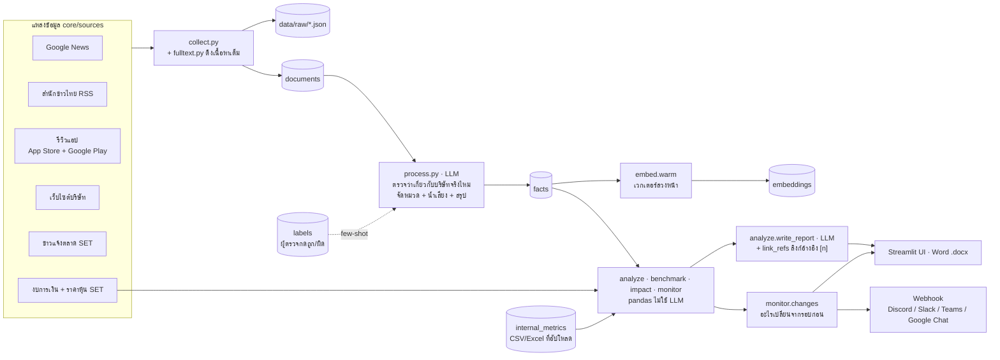
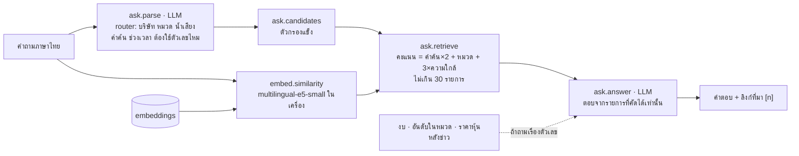

# Architecture

เอกสารนี้อธิบาย 2 อย่าง: (1) mock-up ที่ทำงานจริงตอนนี้บนเครื่อง และ (2) เป้าหมายตอนย้ายขึ้น Huawei Cloud
วิธีใช้งานอยู่ใน [`README.md`](../README.md) ขั้นตอนที่ทำมาอยู่ใน [`mockup-steps.md`](mockup-steps.md)

## ภาพรวม

แอปเป็น Streamlit (`app.py`) ทุกการวิเคราะห์ใช้ `core/pipeline.py` ชุดเดียวกัน ไม่ว่าจะกดในแอป
(ระบบรัน `monitor.py --job` เบื้องหลัง หน้าเว็บไม่ค้าง) หรือรันตามเวลาจาก Windows Task Scheduler (`monitor.py`)
ข้อมูลทั้งหมดอยู่ใน SQLite ไฟล์เดียว (`data/app.db`) LLM คือ `qwen3.5` ผ่าน endpoint ของอาจารย์ (`core/llm.py`)

## ตอนนี้ (mock-up)

### เส้นทางวิเคราะห์

### เส้นทางถามข้อมูล (RAG)

ไม่พบรายการเลยและไม่มีตัวเลขที่เกี่ยว → ตอบว่าไม่พบโดยไม่เรียก LLM ขั้นที่ 2
ถ้าใช้ embedding ไม่ได้ → ค้นด้วยคำค้นอย่างเดียว

### แหล่งข้อมูลและวิธีดึง

ดึงเมื่อกดวิเคราะห์หรือตามรอบอัตโนมัติ (ไม่ real-time) ครั้งละ 3 บริษัทพร้อมกัน แหล่งไหนใช้ไม่ได้จะข้ามและแจ้งเหตุผล
(`SourceSkipped`) ข้อจำกัดฝั่งผู้ใช้ดูตาราง "แหล่งข้อมูล" ใน [`README.md`](../README.md#แหล่งข้อมูล)

| แหล่ง | ได้อะไร | ดึงยังไง | ไฟล์ |
|---|---|---|---|
| Google News | หัวข้อ ลิงก์ วันที่ | RSS ค้นหาของ Google News ด้วยชื่อบริษัท + ชื่อที่สื่อใช้อีก 2 ชื่อ (+ "ชื่อ + หัวข้อที่สนใจ") | `core/sources/google_news.py` |
| สำนักข่าวไทย | ข่าวพร้อมเนื้อหา | RSS ของประชาชาติ มติชน ไทยรัฐ Brand Inside THE STANDARD Blognone เก็บเฉพาะข่าวที่มีชื่อบริษัท/ชื่อเรียก | `core/sources/thai_rss.py` |
| รีวิวแอป | ข้อความ + ดาว | App Store: RSS รีวิวของ Apple · Google Play: `google-play-scraper` (ไม่ใช่ API ทางการ) · หาแอปจากการค้นในสโตร์ หรือตั้งเอง | `core/sources/app_reviews.py` |
| เว็บไซต์บริษัท | ลิงก์บทความหน้าข่าว/โปรโมชัน | `requests` + BeautifulSoup เคารพ `robots.txt` · เว็บที่โหลดด้วย JavaScript ใช้ไม่ได้ | `core/sources/website.py` |
| ข่าวแจ้งตลาด SET | ประกาศย้อนหลัง 90 วัน (หัวข้อ ไม่เปิด PDF แนบ) | API ภายในของ set.or.th (เปิดหน้าแรกเพื่อรับ cookie ก่อน ไม่งั้น 403) | `core/sources/set_api.py` |
| งบการเงิน / ตลาด SET | งบล่าสุด + รายปี อัตราส่วน มูลค่าตลาด ราคาหุ้นรายวัน ตัวเลขทั้งหมวด | API ภายในตัวเดียวกัน · cache 1 วันใน `market_cache` | `set_api.py`, `benchmark.py`, `impact.py` |
| ดึงเนื้อหาเต็ม (ตัวเลือก) | เนื้อหาบทความไม่เกิน 4,000 ตัวอักษร | ถอดลิงก์ Google News ด้วย `googlenewsdecoder` → อ่านบทความด้วย `trafilatura` | `core/fulltext.py` |
| ข้อมูลภายใน (ผู้ใช้อัปโหลด) | ตัวเลข เช่น ยอดขาย NPS | CSV/Excel ทั้งแบบแถวยาวและแบบตาราง | `core/internal.py` |

ทุกแหล่งคืนรูปแบบเดียวกัน (`core/sources/__init__.py` `item()`) → `collect.py` เก็บไฟล์ดิบ + กันซ้ำด้วย hash
→ `process.py` ส่ง LLM เฉพาะรายการใหม่ · ยังไม่มี: โซเชียลมีเดีย (Facebook, X, Pantip) และ PDF แนบของประกาศ SET

### ส่วนประกอบ

| โมดูล | หน้าที่ | LLM |
|---|---|---|
| `core/sources/*` | ดึงข้อมูลแต่ละแหล่ง คืนรูปแบบเดียวกัน (`fetch(company, limit)`) | – |
| `core/collect.py`, `core/fulltext.py` | ดึง เก็บไฟล์ดิบ กันข้อมูลซ้ำด้วย hash · เปิดลิงก์อ่านเนื้อหาเต็ม (trafilatura) | – |
| `core/profile.py` | ชื่อหุ้น SET ชื่อที่สื่อใช้ ธุรกิจหลักของแต่ละบริษัท | 1 ครั้งรวมทุกบริษัท |
| `core/process.py` | ตรวจความเกี่ยวข้อง + จัดหมวด 7 หมวด + น้ำเสียง + สรุป 1 ประโยค (ชุดละ 5–10 รายการ ส่งพร้อมกัน 4 ชุด) | ✓ |
| `core/accuracy.py` | วัดความแม่นจากข่าวที่ผู้ตรวจกด แล้วใช้เป็นตัวอย่างใน prompt ของ `process` | – |
| `core/analyze.py` | ตาราง A/B/C/R/F/gap · เขียนรายงาน · แปลงเลขอ้างอิงเป็นลิงก์ | รายงาน 1 ครั้ง |
| `core/benchmark.py` | อันดับในหมวดธุรกิจ SET ทั้งหมวด | – |
| `core/impact.py` | ราคาหุ้นหลังข่าว หักผลตลาด | – |
| `core/monitor.py` | snapshot ต่อรอบ เทียบรอบก่อน ส่งแจ้งเตือน | – |
| `core/ask.py` | ถามข้อมูล (router → retrieve → answer) | 2 ครั้งต่อคำถาม |
| `core/embed.py` | เวกเตอร์ความหมาย + cache · `EMBED_BACKEND=local` หรือ `api` | – (โมเดล embedding แยก) |
| `core/discover.py`, `core/group.py` | หาคู่แข่ง (Phase 3) · หาบริษัทในเครือ แล้วตรวจกับผู้ถือหุ้นใหญ่ใน SET | ✓ |
| `core/internal.py`, `core/export.py` | อ่าน CSV/Excel ข้อมูลภายใน · ส่งออก Word | – |
| `core/llm.py` | เรียก LLM + บันทึกทุก call ใน `llm_log` + replay | – |
| `ui/nav.py`, `ui/pages/*` | เมนู (`st.navigation`) และหน้าต่าง ๆ: ภาพรวม · วิเคราะห์ใหม่ · ถามข้อมูล · ติดตาม · ข้อมูลภายใน · บริษัทและแหล่งข้อมูล · ตรวจความแม่น | – |
| `ui/state.py` | ผลที่เปิดอยู่ · ค่าฟอร์มที่จำข้ามหน้า · เริ่มงานเบื้องหลังและติดตามความคืบหน้า (fragment ใน sidebar) | – |
| `ui/results.py`, `ui/sections/*`, `ui/*_panel.py` | ส่วนประกอบของหน้า: ผลวิเคราะห์ ตัวกรอง กราฟ การ์ดบริษัท ฯลฯ | – |

### ข้อมูล (SQLite `data/app.db`)

| กลุ่ม | ตาราง |
|---|---|
| ข้อมูลหลัก | `companies` · `documents` (ข่าว/ประกาศ/รีวิว + เนื้อหา) · `facts` (ผล LLM ต่อรายการ) · `financials` · `internal_metrics` · `company_groups` |
| ผลวิเคราะห์ / ติดตาม | `reports` · `runs` (snapshot + สิ่งที่เปลี่ยน) · `watchlists` · `jobs` (งานเบื้องหลัง) |
| ตรวจคุณภาพ | `labels` |
| cache / log | `llm_log` (prompt + คำตอบ ใช้ replay) · `market_cache` (ตัวเลขตลาด 1 วัน) · `embeddings` (เวกเตอร์ float32) |

ไฟล์ดิบอยู่ที่ `data/raw/{company}/{date}_{แหล่ง}.json` · ชุดเดโมอยู่ใน `demo/` (ฐานข้อมูล + ผลรอบล่าสุด)

### หลักการออกแบบ

- **ตัวเลขคิดด้วย pandas เท่านั้น** LLM ได้ตารางที่คิดเสร็จแล้วไปเขียนเป็นภาษาคน ไม่นับหรือคำนวณเอง
- **ตอบจากข้อมูลที่เก็บไว้เท่านั้น** ทุกข้อในรายงานและคำตอบมีเลขอ้างอิงที่ลิงก์ไปต้นทาง ไม่มีข้อมูลก็ตอบว่าไม่มี
- **ไม่ทำงานซ้ำ** ข่าวเดิมไม่ classify ซ้ำ เวกเตอร์ไม่คำนวณซ้ำ ตัวเลขตลาด cache 1 วัน
- **ล่มแล้วยังใช้ได้** SET ใช้ไม่ได้ก็วิเคราะห์ต่อและแจ้งเหตุผล · LLM ล่มใช้คำตอบเดิมของ prompt เดียวกัน (`LLM_REPLAY`)
  · embedding ใช้ไม่ได้ก็ค้นด้วยคำค้น
- **คนยืนยันก่อนเสมอ** ในจุดที่ผิดแล้วกระทบทั้งผล เช่น รายชื่อคู่แข่ง (Phase 3) และบริษัทในเครือ

## เทียบกับรายการเป้าหมาย

| รายการ | สถานะ | ตอนนี้ทำอย่างไร |
|---|---|---|
| OCR (ไฟล์ PDF) | ❌ ยังไม่มี | ประกาศ SET เก็บแค่หัวข้อ · ข้อมูลภายในรับแค่ CSV/Excel |
| Vector search | ✅ มีแล้ว (ขนาด mock-up) | `embed.py` + SQLite + numpy · ผสมกับคำค้น (hybrid) · บน cloud เปลี่ยนเป็น Postgres + pgvector |
| LLM Router (จัดโดเมน) | ✅ มีแล้ว | `ask.parse` แยกบริษัท/หมวด/คำค้นของคำถาม · `process` จัดหมวดของข่าว |
| LLM Detection + summarize | ✅ มีแล้ว | `process` ตัดข่าวที่ชื่อตรงแต่ไม่ใช่บริษัทนั้น + สรุป · `accuracy` วัดผลและป้อนตัวอย่างกลับ |
| UI/UX web | ✅ มีแล้ว | Streamlit |

## เป้าหมายบน Huawei Cloud (แผน ยังไม่ได้ทำ)

แบบเต็ม (รายการ service, containers, ขั้นตอน deploy, สิ่งที่ต้องแก้ในโค้ด) อยู่ใน [`huawei-cloud.md`](huawei-cloud.md) สรุป:

- ECS เครื่องเดียวใน AP-Bangkok รัน Docker Compose: `proxy` (Caddy HTTPS + รหัสผ่าน) · `web` (Streamlit)
  · `worker` (รันรายวัน + หยิบงานจากตาราง `jobs`) · `ocr` (เตรียมไว้)
- RDS for PostgreSQL + pgvector แทน SQLite · OBS เก็บไฟล์ · SWR เก็บ image · Cloud Eye เฝ้าดู
- LLM ยังใช้ endpoint ของอาจารย์ · embedding e5 ฝังอยู่ใน image

## ข้อจำกัดที่รู้

- ข้อมูล SET ใช้ API ภายในของเว็บ set.or.th ไม่ได้เปิดให้ใช้อย่างเป็นทางการ อาจเปลี่ยนหรือถูกบล็อกได้
- key ของ LLM เข้าได้แค่ `qwen3.5` ซึ่งไม่ใช่โมเดล embedding จึงรัน embedding ในเครื่องแทน
- โมเดล e5-small ยังไม่จับคำทับศัพท์ เช่น "ไฟว์จี" กับ "5G" (โมเดลใหญ่กว่าอย่าง `BAAI/bge-m3` อาจดีกว่า แต่หนัก ~2 GB)
- คำถามเรื่องแบรนด์ที่ไม่มีในระบบ + คำทั่วไป (เช่น "Shopee ลดราคา") ยังดึงข่าวลดราคาของบริษัทอื่นมาให้ LLM
- ข้อมูลไม่ real-time ดึงใหม่เมื่อกดวิเคราะห์หรือตามรอบที่ตั้งไว้
