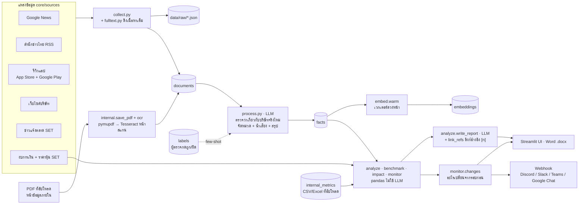
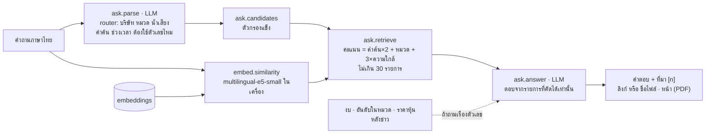

# Architecture

เอกสารนี้อธิบาย 2 อย่าง: (1) mock-up ที่ทำงานจริงตอนนี้บนเครื่อง และ (2) เป้าหมายตอนย้ายขึ้น Huawei Cloud
วิธีใช้งานอยู่ใน [`README.md`](../README.md) ขั้นตอนที่ทำมาอยู่ใน [`mockup-steps.md`](mockup-steps.md)

## ภาพรวม

แอปเป็น Streamlit (`app.py`) ทุกการวิเคราะห์ใช้ `core/pipeline.py` ชุดเดียวกัน ไม่ว่าจะกดในแอป
(ระบบรัน `monitor.py --job` เบื้องหลัง หน้าเว็บไม่ค้าง) หรือรันตามเวลาจาก Windows Task Scheduler (`monitor.py`)
ใน docker (`docker compose up`) ใช้ container `worker` (`worker.py`) หยิบงานจากตาราง `jobs` และรันรายวันตาม `MONITOR_AT` แทน
ข้อมูลทั้งหมดอยู่ในฐานข้อมูลเดียว: PostgreSQL เมื่อตั้ง `DATABASE_URL` (RDS หรือ container `db`) ไม่ตั้ง = SQLite ไฟล์ `data/app.db`
LLM คือ `qwen3.5` ผ่าน endpoint ของอาจารย์ (`core/llm.py`)

## เอกสารรายระบบ

รายละเอียดของแต่ละระบบอยู่ใน [`systems/`](systems/) ทุกไฟล์มีหัวข้อเหมือนกัน:
1. ภาพรวมพร้อมแผนภาพ (อ่านส่วนนี้พอถ้าต้องการแค่หลักการ)
2. ขั้นตอน
3. LLM
4. ข้อมูลที่อ่าน/เขียน
5. ค่าที่ปรับได้
6. เมื่อมีปัญหา
7. สำหรับนักพัฒนา (ฟังก์ชัน จุดที่ต้องแก้เมื่อเพิ่ม feature และเทส)

| ระบบ | เอกสาร | โมดูลหลัก | LLM |
|---|---|---|---|
| ดึงข้อมูล | [`collect.md`](systems/collect.md) | `core/sources/*`, `collect`, `fulltext`, `profile` | 1 ครั้งต่อรอบ เฉพาะบริษัทที่ยังไม่เคยหาข้อมูล |
| จัดหมวด + ตรวจความเกี่ยวข้อง + ตรวจความแม่น | [`classify.md`](systems/classify.md) | `process`, `accuracy` | 1 ครั้งต่อรายการใหม่ 5–10 รายการ |
| วิเคราะห์ + รายงาน + งานเบื้องหลัง | [`analysis-report.md`](systems/analysis-report.md) | `pipeline`, `analyze`, `export`, `monitor.py --job` | 1 ครั้งต่อรายงาน |
| ถามข้อมูล (RAG) | [`ask.md`](systems/ask.md) | `ask`, `embed` | 1–2 ครั้งต่อคำถาม |
| ติดตามอัตโนมัติ + แจ้งเตือน | [`monitor.md`](systems/monitor.md) | `core/monitor`, `monitor.py`, `ui/watch_panel` | – (ใช้ของ pipeline) |
| ข้อมูลตลาดหุ้น | [`market.md`](systems/market.md) | `set_api`, `benchmark`, `impact` | – |
| หาคู่แข่ง + บริษัทในเครือ + รวมบริษัทซ้ำ | [`discover-groups.md`](systems/discover-groups.md) | `discover`, `group` | 3 ครั้งต่อการหาคู่แข่ง · 1 ครั้งต่อการหาบริษัทในเครือ |
| ข้อมูลภายใน + PDF/OCR | [`internal-docs.md`](systems/internal-docs.md) | `internal`, `core/ocr`, `ocr/` | PDF: 1 ครั้งต่อ 5 ส่วน |
| พื้นฐานร่วม | [`platform.md`](systems/platform.md) | `llm`, `db`, `ui/nav`, `ui/state`, โหมดเดโม, เทส | – |

## ตอนนี้ (mock-up)

### Tech stack

| ส่วน | ใช้ | ทำอะไร | ไฟล์ |
|---|---|---|---|
| ภาษา | Python 3.14 (เครื่อง dev, `.venv`) · 3.12 ใน Docker image บน cloud | – | – |
| UI | `streamlit` (`st.navigation`, fragment) · กราฟด้วย `altair` (มากับ streamlit) | หน้าเว็บ เมนู กราฟ ความคืบหน้าใน sidebar | `app.py`, `ui/`, `ui/charts.py` |
| LLM | `qwen3.5` ผ่าน endpoint ของอาจารย์ (แบบ OpenAI `/v1/chat/completions`) เรียกด้วย `requests` · `python-dotenv` อ่าน `.env` | classify สรุป เขียนรายงาน ตอบคำถาม | `core/llm.py` |
| ดึงข่าว RSS | `feedparser` | Google News + สำนักข่าวไทย | `core/sources/google_news.py`, `thai_rss.py` |
| ดึงเว็บ | `requests` + `beautifulsoup4` | เว็บบริษัท เนื้อหาข่าว RSS API ภายในของ SET | `core/sources/website.py`, `thai_rss.py`, `set_api.py` |
| รีวิวแอป | `google-play-scraper` · RSS รีวิวของ Apple | รีวิว Google Play / App Store | `core/sources/app_reviews.py` |
| เนื้อหาเต็ม | `googlenewsdecoder` (ต้องใช้ `selectolax<1.0`) + `trafilatura` | ถอดลิงก์ Google News แล้วอ่านบทความ | `core/fulltext.py` |
| PDF / OCR | `pymupdf` (ข้อความในไฟล์) + Tesseract `tha+eng` ผ่าน `pytesseract` ใน container `ocr/` (FastAPI) เรียกตาม `OCR_URL` | อ่าน PDF ที่อัปโหลด หน้าสแกนใช้ OCR | `core/ocr.py`, `ocr/` |
| คำนวณ | `pandas` · `tabulate` (ใช้กับ `to_markdown` ตอนส่งตารางให้ LLM) · `openpyxl` (อ่าน Excel) | ตารางทุกตัวเลข ข้อมูลภายใน | `core/analyze.py`, `core/internal.py` |
| Embedding | `sentence-transformers` + `intfloat/multilingual-e5-small` · torch แบบ CPU · ความใกล้ (cosine) คิดด้วย pgvector ใน PostgreSQL หรือ `numpy` เมื่อใช้ SQLite | ค้นด้วยความหมายในหน้าถามข้อมูล | `core/embed.py` |
| ฐานข้อมูล | PostgreSQL (`psycopg` + pool, pgvector) เมื่อตั้ง `DATABASE_URL` · ไม่ตั้ง = SQLite (`sqlite3` ในตัว Python) · ไฟล์ดิบ `data/raw/*.json` | เก็บทุกอย่าง ดูหัวข้อ "ข้อมูล" | `core/db.py` |
| ส่งออก | `python-docx` | รายงาน Word | `core/export.py` |
| งานเบื้องหลัง | บนเครื่อง: `subprocess` (`monitor.py --job`) + Windows Task Scheduler (`schtasks`) · ใน docker (`CC_JOB_QUEUE=1`): container `worker` (`worker.py`) หยิบงานจากตาราง `jobs` + รันรายวันตาม `MONITOR_AT` · `ThreadPoolExecutor` | วิเคราะห์ไม่ให้หน้าเว็บค้าง · รันรายวัน · ดึง/classify พร้อมกัน | `ui/watch_panel.py`, `worker.py`, `monitor.py`, `core/pipeline.py` |
| แจ้งเตือน | webhook ผ่าน `requests` | Discord / Slack / Teams / Google Chat | `core/monitor.py` |
| ทดสอบ | `pytest` (`requirements-dev.txt`) · ตั้ง `TEST_DATABASE_URL` = รันกับ PostgreSQL | unit test | `tests/` |
| deploy | Docker Compose · `caddy:2` (HTTPS อัตโนมัติ · รหัสผ่านเมื่อตั้ง `BASIC_AUTH_HASH`) · `pgvector/pgvector:pg16` (profile `localdb`) · image `quix07/competitor-app` / `competitor-ocr` บน Docker Hub | รันทั้งระบบบนเครื่องหรือ ECS | `Dockerfile`, `docker-compose.yml`, `deploy/`, `DEPLOY.md` |

`requirements.txt` ไม่ได้ pin เวอร์ชัน · torch ให้ลงแบบ CPU ก่อน: `pip install torch --index-url https://download.pytorch.org/whl/cpu`

### เส้นทางวิเคราะห์

ดูแบบโต้ตอบ (archify): [analysis-pipeline.html](diagrams/analysis-pipeline.html)

PDF ที่อัปโหลดเก็บใน `documents` ด้วย `source_type = 'document'` ผ่านการจัดหมวดเหมือนข่าว แต่ไม่เข้าตาราง A/B/C, gap
และการเทียบรอบของ monitor (`analyze.news_only`) เพราะมีแค่บางบริษัท ใช้ในเส้นทางถามข้อมูลด้านล่างเท่านั้น

### เส้นทางถามข้อมูล (RAG)

ดูแบบโต้ตอบ (archify): [ask-rag.html](diagrams/ask-rag.html)

ไม่พบรายการเลยและไม่มีตัวเลขที่เกี่ยว → ตอบว่าไม่พบโดยไม่เรียก LLM ขั้นที่ 2
ถ้าใช้ embedding ไม่ได้ → ค้นด้วยคำค้นอย่างเดียว

### แหล่งข้อมูลและวิธีดึง

ดึงเมื่อกดวิเคราะห์หรือตามรอบอัตโนมัติ (ไม่ real-time) ครั้งละ 3 บริษัทพร้อมกัน แหล่งไหนใช้ไม่ได้จะข้ามและแจ้งเหตุผล
(`SourceSkipped`) ข้อจำกัดฝั่งผู้ใช้ดูตาราง "แหล่งข้อมูล" ใน [`README.md`](../README.md#แหล่งข้อมูล)

| แหล่ง | ได้อะไร | ดึงยังไง | ไฟล์ |
|---|---|---|---|
| Google News | หัวข้อ ลิงก์ วันที่ | RSS ค้นหาของ Google News ด้วยชื่อบริษัท + ชื่อที่สื่อใช้อีก 2 ชื่อ (+ "ชื่อ + หัวข้อที่สนใจ") | `core/sources/google_news.py` |
| สำนักข่าวไทย | ข่าวพร้อมเนื้อหา | RSS ของประชาชาติ มติชน ไทยรัฐ Brand Inside THE STANDARD Blognone เก็บเฉพาะข่าวที่มีชื่อบริษัท/ชื่อเรียก | `core/sources/thai_rss.py` |
| รีวิวแอป | ข้อความ + ดาว | App Store: RSS รีวิวของ Apple · Google Play: `google-play-scraper` (ไม่ใช่ API ทางการ) · หาแอปจากการค้นในสโตร์ หรือตั้งเอง | `core/sources/app_reviews.py` |
| เว็บไซต์บริษัท | ลิงก์บทความหน้าข่าว/โปรโมชัน | `requests` + BeautifulSoup เคารพ `robots.txt` · เว็บที่โหลดด้วย JavaScript ใช้ไม่ได้ | `core/sources/website.py` |
| ข่าวแจ้งตลาด SET | ประกาศย้อนหลัง 90 วัน (หัวข้อ ไม่เปิด PDF แนบ) | API ภายในของ set.or.th (เปิดหน้าแรกเพื่อรับ cookie ก่อน ไม่งั้น 403) | `core/sources/set_api.py` |
| งบการเงิน / ตลาด SET | งบล่าสุด + รายปี อัตราส่วน มูลค่าตลาด ราคาหุ้นรายวัน ตัวเลขทั้งหมวด | API ภายในตัวเดียวกัน · cache 1 วันใน `market_cache` | `set_api.py`, `benchmark.py`, `impact.py` |
| ดึงเนื้อหาเต็ม (ตัวเลือก) | เนื้อหาบทความไม่เกิน 4,000 ตัวอักษร | ถอดลิงก์ Google News ด้วย `googlenewsdecoder` → อ่านบทความด้วย `trafilatura` | `core/fulltext.py` |
| ข้อมูลภายใน (ผู้ใช้อัปโหลด) | ตัวเลข เช่น ยอดขาย NPS | CSV/Excel ทั้งแบบแถวยาวและแบบตาราง | `core/internal.py` |
| เอกสาร PDF (ผู้ใช้อัปโหลด) | ข้อความทีละส่วน ~1,500 ตัวอักษร พร้อมเลขหน้า (ครั้งละไม่เกิน 30 หน้า) | `pymupdf` อ่านข้อความในไฟล์ → หน้าที่เป็นภาพหรือข้อความเพี้ยน (ฟอนต์ไทย map ผิด) ส่ง OCR ตาม `OCR_URL` | `core/internal.py`, `core/ocr.py`, `ocr/` |

ทุกแหล่งคืนรูปแบบเดียวกัน (`core/sources/__init__.py` `item()`) → `collect.py` เก็บไฟล์ดิบ + กันซ้ำด้วย hash
→ `process.py` ส่ง LLM เฉพาะรายการใหม่ · ยังไม่มี: โซเชียลมีเดีย (Facebook, X, Pantip) และ PDF แนบของประกาศ SET

### ส่วนประกอบ

| โมดูล | หน้าที่ | LLM | เอกสาร |
|---|---|---|---|
| `core/sources/*` | ดึงข้อมูลแต่ละแหล่ง คืนรูปแบบเดียวกัน (`fetch(company, limit)`) | – | [collect](systems/collect.md) |
| `core/collect.py`, `core/fulltext.py` | ดึง เก็บไฟล์ดิบ กันข้อมูลซ้ำด้วย hash · เปิดลิงก์อ่านเนื้อหาเต็ม (trafilatura) | – | [collect](systems/collect.md) |
| `core/profile.py` | ชื่อหุ้น SET ชื่อที่สื่อใช้ ธุรกิจหลักของแต่ละบริษัท | 1 ครั้งรวมทุกบริษัท | [collect](systems/collect.md) |
| `core/process.py` | ตรวจความเกี่ยวข้อง + จัดหมวด 7 หมวด + น้ำเสียง + สรุป 1 ประโยค (ชุดละ 5–10 รายการ ส่งพร้อมกัน 4 ชุด) | ✓ | [classify](systems/classify.md) |
| `core/accuracy.py` | วัดความแม่นจากข่าวที่ผู้ตรวจกด แล้วใช้เป็นตัวอย่างใน prompt ของ `process` | – | [classify](systems/classify.md) |
| `core/pipeline.py` | ลำดับขั้นการวิเคราะห์ ใช้ร่วมกันระหว่างแอปและ `monitor.py` | – | [analysis-report](systems/analysis-report.md) |
| `core/analyze.py` | ตาราง A/B/C/R/F/gap · เขียนรายงาน · แปลงเลขอ้างอิงเป็นลิงก์ | รายงาน 1 ครั้ง | [analysis-report](systems/analysis-report.md) |
| `core/benchmark.py` | อันดับในหมวดธุรกิจ SET ทั้งหมวด | – | [market](systems/market.md) |
| `core/impact.py` | ราคาหุ้นหลังข่าว หักผลตลาด | – | [market](systems/market.md) |
| `core/monitor.py` | snapshot ต่อรอบ เทียบรอบก่อน ส่งแจ้งเตือน | – | [monitor](systems/monitor.md) |
| `core/ask.py` | ถามข้อมูล (router → retrieve → answer) | 1–2 ครั้งต่อคำถาม | [ask](systems/ask.md) |
| `core/embed.py` | เวกเตอร์ความหมาย + cache · `EMBED_BACKEND=local` หรือ `api` | – (โมเดล embedding แยก) | [ask](systems/ask.md) |
| `core/discover.py`, `core/group.py` | หาคู่แข่ง (Phase 3) · หาบริษัทในเครือ แล้วตรวจกับผู้ถือหุ้นใหญ่ใน SET | ✓ | [discover-groups](systems/discover-groups.md) |
| `core/internal.py` | อ่าน CSV/Excel ข้อมูลภายใน · บันทึก PDF ที่อัปโหลดเป็นส่วน ๆ | – | [internal-docs](systems/internal-docs.md) |
| `core/ocr.py`, `ocr/` | อ่าน PDF ทีละหน้า: ส่งไป container `ocr` (FastAPI `POST /extract`) หรืออ่านในแอปเมื่อไม่ตั้ง `OCR_URL` · ตัดเป็นส่วน | – | [internal-docs](systems/internal-docs.md) |
| `core/export.py` | ส่งออกรายงาน Word | – | [analysis-report](systems/analysis-report.md) |
| `core/llm.py`, `core/db.py` | เรียก LLM + บันทึกทุก call ใน `llm_log` + replay · PostgreSQL / SQLite | – | [platform](systems/platform.md) |
| `ui/nav.py`, `ui/pages/*` | เมนู (`st.navigation`) และหน้าต่าง ๆ: ภาพรวม · วิเคราะห์ใหม่ · ถามข้อมูล · ติดตาม · ข้อมูลภายใน · บริษัทและแหล่งข้อมูล · ตรวจความแม่น | – | [platform](systems/platform.md) |
| `ui/state.py` | ผลที่เปิดอยู่ · ค่าฟอร์มที่จำข้ามหน้า · เริ่มงานเบื้องหลังและติดตามความคืบหน้า (fragment ใน sidebar) | – | [platform](systems/platform.md) |
| `ui/results.py`, `ui/sections/*`, `ui/*_panel.py` | ส่วนประกอบของหน้า: ผลวิเคราะห์ ตัวกรอง กราฟ การ์ดบริษัท ฯลฯ | – | ในแต่ละระบบ |

### ข้อมูล (ตารางในฐานข้อมูล)

| กลุ่ม | ตาราง |
|---|---|
| ข้อมูลหลัก | `companies` · `documents` (ข่าว/ประกาศ/รีวิว/PDF ที่อัปโหลด + เนื้อหา) · `facts` (ผล LLM ต่อรายการ) · `financials` · `internal_metrics` · `company_groups` |
| ผลวิเคราะห์ / ติดตาม | `reports` · `runs` (snapshot + สิ่งที่เปลี่ยน) · `watchlists` · `jobs` (งานเบื้องหลัง) |
| ตรวจคุณภาพ | `labels` |
| cache / log | `llm_log` (prompt + คำตอบ ใช้ replay) · `market_cache` (ตัวเลขตลาด 1 วัน) · `embeddings` (เวกเตอร์: ชนิด `vector` ใน PostgreSQL · bytes float32 ใน SQLite) |

ไฟล์ดิบอยู่ที่ `data/raw/{company}/{date}_{แหล่ง}.json` · PDF ต้นฉบับที่ `data/uploads/<sha256>.pdf` · ชุดเดโมอยู่ใน `demo/` (ฐานข้อมูล + ผลรอบล่าสุด)

### หลักการออกแบบ

- **ตัวเลขคิดด้วย pandas เท่านั้น** LLM ได้ตารางที่คิดเสร็จแล้วไปเขียนเป็นภาษาคน ไม่นับหรือคำนวณเอง
- **ตอบจากข้อมูลที่เก็บไว้เท่านั้น** ทุกข้อในรายงานและคำตอบมีเลขอ้างอิงที่ลิงก์ไปต้นทาง ไม่มีข้อมูลก็ตอบว่าไม่มี
- **ไม่ทำงานซ้ำ** ข่าวเดิมไม่ classify ซ้ำ เวกเตอร์ไม่คำนวณซ้ำ ตัวเลขตลาด cache 1 วัน
- **ล่มแล้วยังใช้ได้** SET ใช้ไม่ได้ก็วิเคราะห์ต่อและแจ้งเหตุผล · LLM ล่มใช้คำตอบเดิมของ prompt เดียวกัน (`LLM_REPLAY`)
  · embedding ใช้ไม่ได้ก็ค้นด้วยคำค้น
- **คนยืนยันก่อนเสมอ** ในจุดที่ผิดแล้วกระทบทั้งผล เช่น รายชื่อคู่แข่ง (Phase 3) และบริษัทในเครือ

## เทียบกับรายการเป้าหมาย

| รายการ | สถานะ | ตอนนี้ทำอย่างไร |
|---|---|---|
| OCR (ไฟล์ PDF) | ✅ มีแล้ว (PDF ที่อัปโหลด) | `ocr/` (pymupdf + Tesseract ไทย) · ค้นและอ้างอิงได้ในแท็บถาม · ยังไม่ทำ: PDF แนบของประกาศ SET และข่าวที่ลิงก์เป็น PDF |
| Vector search | ✅ มีแล้ว | `embed.py` · PostgreSQL คิดความใกล้ด้วย pgvector · SQLite คิดด้วย numpy · ผสมกับคำค้น (hybrid) |
| LLM Router (จัดโดเมน) | ✅ มีแล้ว | `ask.parse` แยกบริษัท/หมวด/คำค้นของคำถาม · `process` จัดหมวดของข่าว |
| LLM Detection + summarize | ✅ มีแล้ว | `process` ตัดข่าวที่ชื่อตรงแต่ไม่ใช่บริษัทนั้น + สรุป · `accuracy` วัดผลและป้อนตัวอย่างกลับ |
| UI/UX web | ✅ มีแล้ว | Streamlit |

## บน Huawei Cloud

โค้ดและ docker พร้อมแล้ว (รันทั้งระบบด้วย `docker compose` ได้ ทดสอบในเครื่องแล้ว) · ที่ยังไม่ได้ทำคือสร้าง resource บน Huawei Cloud
(VPC, ECS, RDS, ฯลฯ) · ขั้นตอนขึ้นระบบทั้งหมด (console → เปิดเว็บ) อยู่ใน [`DEPLOY.md`](../DEPLOY.md) เล่มเดียว · แผนและเหตุผล (รายการ service, ค่าใช้จ่าย) อยู่ใน [`huawei-cloud.md`](huawei-cloud.md)

| ส่วน | รันบนเครื่อง (dev) | บน cloud | สถานะ |
|---|---|---|---|
| รันแอป | `streamlit run` | ECS เครื่องเดียวใน AP-Bangkok · Docker Compose: `proxy` (Caddy HTTPS + รหัสผ่านถ้าตั้ง) · `web` (Streamlit) · `ocr` (`OCR_URL=http://ocr:8000`) | ✅ พร้อม |
| งานเบื้องหลัง / ตั้งเวลา | `subprocess` + Windows Task Scheduler | container `worker` รันรายวัน + หยิบงานจากตาราง `jobs` | ✅ พร้อม |
| ฐานข้อมูล | SQLite (หรือ PostgreSQL เมื่อตั้ง `DATABASE_URL`) | RDS for PostgreSQL (หรือ container `db`) · ย้ายข้อมูลด้วย `migrate_to_postgres.py` | ✅ พร้อม · ต้องสร้าง RDS |
| เวกเตอร์ | ตาราง `embeddings` + numpy | pgvector | ✅ พร้อม |
| ไฟล์ดิบ / PDF / log | `data/` | volume `app_data` บนดิสก์ ECS (ไม่ใช้ OBS · ย้ายไป OBS เฉพาะเมื่อแยกหลายเครื่อง) | ✅ พร้อม |
| image / เฝ้าดู | – | Docker Hub (`quix07/*`) หรือ SWR · Cloud Eye | image พร้อม · Cloud Eye ยังไม่ตั้ง |
| LLM / embedding | endpoint ของอาจารย์ · e5 ในเครื่อง | ไม่เปลี่ยน (e5 ฝังอยู่ใน image) | ✅ |

## ข้อจำกัดที่รู้

- ข้อมูล SET ใช้ API ภายในของเว็บ set.or.th ไม่ได้เปิดให้ใช้อย่างเป็นทางการ อาจเปลี่ยนหรือถูกบล็อกได้
- key ของ LLM เข้าได้แค่ `qwen3.5` ซึ่งไม่ใช่โมเดล embedding จึงรัน embedding ในเครื่องแทน
- โมเดล e5-small ยังไม่จับคำทับศัพท์ เช่น "ไฟว์จี" กับ "5G" (โมเดลใหญ่กว่าอย่าง `BAAI/bge-m3` อาจดีกว่า แต่หนัก ~2 GB)
- คำถามเรื่องแบรนด์ที่ไม่มีในระบบ + คำทั่วไป (เช่น "Shopee ลดราคา") ยังดึงข่าวลดราคาของบริษัทอื่นมาให้ LLM
- ข้อมูลไม่ real-time ดึงใหม่เมื่อกดวิเคราะห์หรือตามรอบที่ตั้งไว้
- OCR ภาษาไทยของ Tesseract พลาดวรรณยุกต์/สระบนบางตัว (เช่น "เพิ่มขึ้น" → "เพิมขืน") และอ่านตารางหรือหลายคอลัมน์ในหน้าสแกนเรียงไม่ดี
- PDF อ่านได้ครั้งละ 30 หน้า ไฟล์ยาว (เช่น 56-1) ต้องอัปโหลดซ้ำทีละช่วง
