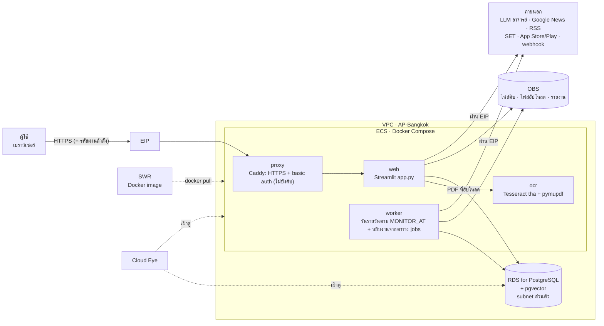

# แผนขึ้น Huawei Cloud

แบบสำหรับ **เดโม/ส่งงาน**: ผู้ใช้ไม่กี่คน (ทีม + อาจารย์) เน้นถูกและดูแลง่าย ทุกอย่างรันเป็น Docker บนเครื่อง ECS เครื่องเดียว
ฐานข้อมูลแยกไปใช้ RDS PostgreSQL + pgvector · LLM ยังใช้ endpoint ของอาจารย์ · embedding (e5) รันใน container
ภาพรวมของระบบตอนนี้ดู [`architecture.md`](architecture.md)

> **สถานะ:** เฟส 1 (Docker Compose + worker + Caddy) **ทำแล้ว** · เฟส 2 ส่วนฐานข้อมูล (PostgreSQL + pgvector, สคริปต์ย้ายข้อมูล) **ทำแล้ว**
> ตั้ง `DATABASE_URL` ชี้ RDS หรือใช้ container `db` (`--profile localdb`) ไม่ตั้ง = SQLite แบบเดิม · ขั้นตอนอยู่ใน [`DEPLOY.md`](../DEPLOY.md)
> ที่ยังไม่ทำ: ไฟล์ไป OBS (ตัดสินใจเก็บใน volume บน ECS ไปก่อน) · ยังไม่ได้สร้าง resource บน Huawei Cloud

**Region:** AP-Bangkok (`ap-southeast-2`) ข้อมูลอยู่ในไทย และใกล้ผู้ใช้/แหล่งข่าวไทย

## แผนภาพ

ดูแบบโต้ตอบ (archify): [huawei-cloud.html](diagrams/huawei-cloud.html)

ทุกอย่างวิ่งออกเน็ตผ่าน EIP ของ ECS (เรียก LLM ดึงข่าว ส่งแจ้งเตือน) จึงไม่ต้องใช้ NAT Gateway
RDS ไม่มี IP สาธารณะ รับการเชื่อมต่อจาก ECS เท่านั้น

## รายการ service

| Service | ใช้ทำอะไร | ขนาดสำหรับเดโม |
|---|---|---|
| **VPC + Subnet + Security Group** | เครือข่ายส่วนตัว · SG ของ ECS เปิดแค่ 80/443 (และ 22 เฉพาะ IP ทีม) · SG ของ RDS รับ 5432 จาก SG ของ ECS เท่านั้น | – |
| **ECS** | รัน Docker Compose ทั้งหมด | 4 vCPU / 8 GB (torch + โมเดล e5 + Streamlit + งานวิเคราะห์) · Ubuntu 22.04 · ดิสก์ EVS 40 GB |
| **EIP + Bandwidth** | IP สาธารณะ: รับผู้ใช้ และออกไป LLM/แหล่งข่าว | ~5 Mbit/s คิดตาม traffic |
| **RDS for PostgreSQL** | แทน SQLite ทุกตาราง · extension `pgvector` เก็บเวกเตอร์และค้นความใกล้ | single instance 2 vCPU / 4 GB · ดิสก์ 40 GB · backup อัตโนมัติ 7 วัน |
| **OBS** | ไฟล์ดิบ (`data/raw`) · ไฟล์ที่อัปโหลด (CSV/Excel/PDF) · รายงาน .docx | Standard bucket ส่วนตัว |
| **SWR** | เก็บ Docker image ส่วนตัว: build บนเครื่องเรา → push → ECS pull | organization เดียว |
| **Cloud Eye** | กราฟและแจ้งเตือน CPU / RAM / ดิสก์ ของ ECS และ RDS | ค่าเริ่มต้น + alarm ดิสก์ > 80% |
| DEW / CSMS (ไม่บังคับ) | เก็บ `LLM_API_KEY` รหัส DB และ webhook แทนไฟล์ `.env` | เดโมใช้ `.env` บน ECS (`chmod 600`) ได้ |
| OCR ของ Huawei (ทางเลือก) | ถ้า General Text OCR รองรับภาษาไทย ใช้แทน container `ocr` ได้ | ต้องทดสอบกับ PDF ไทยก่อน |
| DNS (ไม่บังคับ) | ชื่อโดเมนสำหรับ HTTPS · ไม่มีโดเมนใช้ `<EIP>.sslip.io` ได้ | – |

ไม่ใช้ในรอบเดโม (ค่อยเพิ่มเมื่อผู้ใช้มากขึ้น): CCE (Kubernetes) · ELB · DMS (queue) · NAT Gateway · ModelArts

## Containers

ใช้ image แอปเดียว (`competitor-app`) สำหรับทั้ง `web` และ `worker` ต่างกันแค่คำสั่งที่รัน

| Container | Image | หน้าที่ | พอร์ต |
|---|---|---|---|
| `proxy` | `caddy:2` | HTTPS (Let's Encrypt อัตโนมัติ) + basic auth เมื่อตั้ง `BASIC_AUTH_HASH` (ว่าง = ไม่มีรหัส ใช้ `deploy/Caddyfile` · มีค่า = `Caddyfile.auth`) · ส่งต่อ websocket ของ Streamlit | 80, 443 ออกนอก |
| `web` | `competitor-app` | `streamlit run app.py` | 8501 ภายในเท่านั้น |
| `worker` | `competitor-app` | `python worker.py`: ทุก 5 วินาทีหยิบงาน `queued` จากตาราง `jobs` (`claim_job`) แล้วรัน `monitor.run_job` · ถึงเวลา `MONITOR_AT` รันทุกชุดติดตามวันละครั้ง · เริ่มใหม่ = ปิดงานที่ค้าง `running` เป็น error | – |
| `db` (profile `localdb`) | `pgvector/pgvector:pg16` | PostgreSQL + pgvector บน ECS เครื่องเดียวกัน ใช้แทน RDS ตอนทดสอบหรือยังไม่มี RDS | 5432 ภายในเท่านั้น |
| `ocr` (profile `ocr`) | `competitor-ocr` (build จาก `ocr/`) | `POST /extract` รับ PDF คืนข้อความทีละหน้า: ใช้ข้อความในไฟล์ก่อน OCR (Tesseract `tha+eng`) เฉพาะหน้าที่เป็นภาพหรือข้อความเพี้ยน | 8000 ภายในเท่านั้น |

**image `competitor-app`:** `python:3.12-slim` + torch แบบ CPU + `requirements.txt` + โมเดล `intfloat/multilingual-e5-small`
ดาวน์โหลดฝังไว้ตอน build (container ไม่ต้องโหลดโมเดลตอนเริ่ม และรันได้แม้ Hugging Face ล่ม) ดาวน์โหลดราว 1.2 GB · บนดิสก์ราว 4.3 GB

**config ผ่าน env (ไฟล์ `.env` บน ECS):**

| ตัวแปร | ค่า |
|---|---|
| `LLM_API_KEY` | key ของอาจารย์ |
| `DATABASE_URL` | `postgresql://app:<รหัส>@<IP ส่วนตัวของ RDS>:5432/competitor` |
| `OBS_ENDPOINT`, `OBS_BUCKET`, `OBS_AK`, `OBS_SK` | ที่เก็บไฟล์ (หรือใช้ agency ของ ECS แทน AK/SK) |
| `EMBED_BACKEND` | `local` |
| `ALERT_WEBHOOK_URL` | ไม่บังคับ |
| `MONITOR_AT` | เวลารันอัตโนมัติ เช่น `07:00` (เวลาไทย) |
| `OCR_URL` | `http://ocr:8000` เมื่อเปิด profile `ocr` (เว้นว่าง = อ่านเฉพาะ PDF ที่มีข้อความในไฟล์) |
| `BASIC_AUTH_USER`, `BASIC_AUTH_HASH` | รหัสเข้าเว็บของ Caddy (`caddy hash-password`) · ไม่บังคับ: ว่าง = ทุกคนที่มีลิงก์เข้าได้ |

ไฟล์จริงอยู่ที่ [`docker-compose.yml`](../docker-compose.yml) (`web` กับ `worker` ใช้ image เดียวกัน · ฐานข้อมูลตาม `DATABASE_URL` · ไฟล์ดิบ/อัปโหลด/log อยู่ใน volume `app_data`)
บน ECS ตั้ง `APP_IMAGE=swr.ap-southeast-2.myhuaweicloud.com/<org>/competitor-app:<tag>` และ `OCR_IMAGE` ใน `.env` แล้ว `docker compose pull`

## สิ่งที่ต้องแก้ในโค้ดก่อนขึ้นจริง

| # | ไฟล์ | ต้องแก้ |
|---|---|---|
| 1 | `core/db.py` | **ทำแล้ว** · ตั้ง `DATABASE_URL` = PostgreSQL (psycopg + connection pool) ไม่ตั้ง = SQLite · SQL ชุดเดียวใช้ได้ทั้งสองแบบ (`ON CONFLICT`, `RETURNING id`, `CASE` แทน boolean) · schema แปลงตอนสร้าง (`SERIAL`, `DOUBLE PRECISION`, `vector`) · `ADD COLUMN IF NOT EXISTS` · ตัดตัวอักษร NUL ก่อนบันทึก |
| 2 | `core/embed.py` | **ทำแล้ว** · `embeddings.vec` เป็น `vector` (ไม่ระบุมิติ ใช้ได้ทั้งโมเดล local และ api) · ความใกล้คิดใน DB ด้วย `1 - (vec <=> q)` กับทุกรายการของผลที่เปิดอยู่ (ไม่ใช้ index top-k เพราะ `ask.py` ใช้คะแนนทุกรายการ) · ไม่มี pgvector = เก็บ bytea คิดด้วย numpy |
| 3 | `core/collect.py`, `core/internal.py` | **ยังไม่ทำ (ตัดสินใจแล้ว)** · ไฟล์ดิบและ PDF ต้นฉบับแอปเขียนเก็บไว้เฉย ๆ ไม่อ่านกลับ จึงเก็บใน volume บน ECS ก่อน ย้ายไป OBS เมื่อจะแยก web/worker หลายเครื่อง |
| 4 | `ui/watch_panel.py`, `ui/state.py` | **ทำแล้ว** (เมื่อ `CC_JOB_QUEUE=1` ซึ่งตั้งไว้ใน image) · ตัด `schtasks` (ใช้ได้แค่ Windows) และ `subprocess.Popen` · ปุ่ม "เริ่มวิเคราะห์"/"รันตอนนี้" แค่สร้างแถวใน `jobs` สถานะ `queued` ให้ worker หยิบ · เวลารันรายวันมาจาก `MONITOR_AT` |
| 5 | ใหม่ `worker.py` | **ทำแล้ว** (`UPDATE … RETURNING` · PostgreSQL ใช้ `FOR UPDATE SKIP LOCKED`) · วนทุก 5 วินาที: หยิบงาน `queued` → รัน `pipeline.run` · ถึงเวลา `MONITOR_AT` → รันชุดติดตามทั้งหมดเหมือน `monitor.py` |
| 6 | ใหม่ `Dockerfile`, `docker-compose.yml`, `Caddyfile`, `.dockerignore` | **ทำแล้ว** · `.dockerignore` ต้องตัด `.env`, `data/`, `.venv/`, `.git/` |
| 7 | ใหม่ `migrate_to_postgres.py` | **ทำแล้ว** · copy SQLite → PostgreSQL ใน transaction เดียว คง id เดิม ข้ามแถวที่ชี้ข้อมูลที่ไม่มีแล้ว ตั้งเลขรันต่อ · ไม่ย้ายซ้ำถ้ามีบริษัทอยู่แล้ว |
| 8 | OCR | **ทำแล้ว** สำหรับ PDF ที่อัปโหลดในหน้าข้อมูลภายใน: `ocr/` (FastAPI + pymupdf + Tesseract) เรียกผ่าน `core/ocr.py` ตาม `OCR_URL` · ที่ยังไม่ทำ: ข่าวที่ลิงก์เป็น PDF และงบการเงินจาก SET |

ตาราง `jobs` ใช้เป็น queue (สถานะ `queued` → `running` → `done` / `error`) ไม่ต้องใช้ DMS · worker เริ่มใหม่จะปิดงานที่ค้าง `running` เป็น `error`

## ขั้นตอน deploy

1. สร้าง VPC + subnet + Security Group 2 ชุด (ECS, RDS)
2. สร้าง RDS for PostgreSQL ใน subnet ส่วนตัว → สร้าง user `app` / database `competitor` → `CREATE EXTENSION vector;` (คำสั่งอยู่ใน `DEPLOY.md`)
3. สร้าง OBS bucket ส่วนตัว
4. สร้าง ECS + EIP → ลง Docker + compose plugin → เปิด Cloud Eye agent
5. บนเครื่องเรา: `docker build` 2 image (`competitor-app` จากโฟลเดอร์หลัก · `competitor-ocr` จาก `ocr/`) → `docker push` ไป SWR
6. บน ECS: วาง `.env` (มี `OCR_URL=http://ocr:8000`), `docker-compose.yml`, `Caddyfile` → `docker compose --profile ocr up -d`
   (ไม่ใช้ OCR: `docker compose up -d` และเว้น `OCR_URL` ว่าง)
7. ย้ายข้อมูลจาก SQLite (ครั้งเดียว): `docker compose exec worker python migrate_to_postgres.py /app/data/import.db`
8. ตั้ง DNS (หรือใช้ `<EIP>.sslip.io`) → เปิด `https://…` (ใส่รหัสถ้าตั้ง `BASIC_AUTH_HASH`) → กดวิเคราะห์ 1 รอบ และถาม 1 คำถาม

**ยังไม่มี RDS:** ข้ามข้อ 2 และใช้ container `db` แทน (`--profile localdb` · `DATABASE_URL=postgresql://app:<รหัส>@db:5432/competitor`)
หรือเว้น `DATABASE_URL` ว่างให้ใช้ SQLite แบบเดิม · ข้อ 3 (OBS) ข้ามได้เสมอ ไฟล์อยู่ใน volume `app_data`
ข้อเสีย: ข้อมูลอยู่บนดิสก์ ECS เครื่องเดียว ต้องสำรองเอง (`pg_dump` ดู `DEPLOY.md`) และตั้ง snapshot ของดิสก์ EVS แทน backup ของ RDS

## ค่าใช้จ่ายโดยประมาณ

เดโมไม่ต้องเปิดตลอด เลือกแบบ **pay-per-use** แล้วปิด ECS/RDS เมื่อไม่ใช้
ราคาจริงขึ้นกับ region และโปรโมชัน ให้คำนวณด้วย Pricing Calculator ของ Huawei Cloud ก่อนสร้าง
(ส่วนที่แพงสุดคือ ECS 4 vCPU / 8 GB และ RDS ส่วน OBS, SWR, Cloud Eye เกือบไม่มีค่าใช้จ่ายที่ขนาดนี้)
ถ้างบจำกัด: ลด ECS เหลือ 2 vCPU / 4 GB ได้ แต่คำถามแรกหลังเปิดเครื่อง (โหลดโมเดล) และการคำนวณเวกเตอร์จะช้าลง

## ต้องตรวจใน console ก่อนสร้าง

ค้นเอกสารแล้วยังยืนยันไม่ได้:

- **RDS for PostgreSQL ใน AP-Bangkok เปิด `pgvector` ได้ไหม และรุ่นไหน** เอกสาร Huawei ที่พบระบุ PG 12–14 (หน้าอาจเก่า)
  ตรวจด้วย `SELECT name FROM pg_available_extensions WHERE name = 'vector';`
  ถ้าไม่มี: แอปยังทำงานได้ (เก็บเวกเตอร์เป็น bytea คิดความใกล้ด้วย numpy) หรือใช้ container `db` (`pgvector/pgvector:pg16`, `--profile localdb`) แทน RDS
- **SWR มีใน AP-Bangkok ไหม** ถ้าไม่มี ใช้ SWR region ใกล้สุด หรือ build image บน ECS ตรง ๆ
- **General Text OCR ของ Huawei รองรับภาษาไทยไหม** ที่ยืนยันได้มีแค่บัตรประชาชนไทยและป้ายทะเบียนไทยใน AP-Bangkok
  ถ้าไม่รองรับ ใช้ container `ocr` (Tesseract) ตามแบบ
- **endpoint ของอาจารย์รับ request จาก IP ของ Huawei Cloud ไหม** (บางเครื่องจำกัด IP)

## ขยายเมื่อผู้ใช้มากขึ้น

| ตอนนี้ | ขยายเป็น |
|---|---|
| ECS เครื่องเดียว + Compose | CCE (Kubernetes) ใช้ image เดิม แยก `web` หลาย replica + ELB |
| ตาราง `jobs` เป็น queue | DMS (Kafka/RabbitMQ) เมื่อ worker หลายเครื่อง |
| e5 ใน container | embedding API (ตั้ง `EMBED_BACKEND=api`) หรือ ModelArts |
| basic auth (ไม่บังคับ รหัสชุดเดียว) | ระบบ login จริง (เช่น IAM/OIDC ผ่าน proxy) |
| RDS single | RDS แบบ primary/standby |
