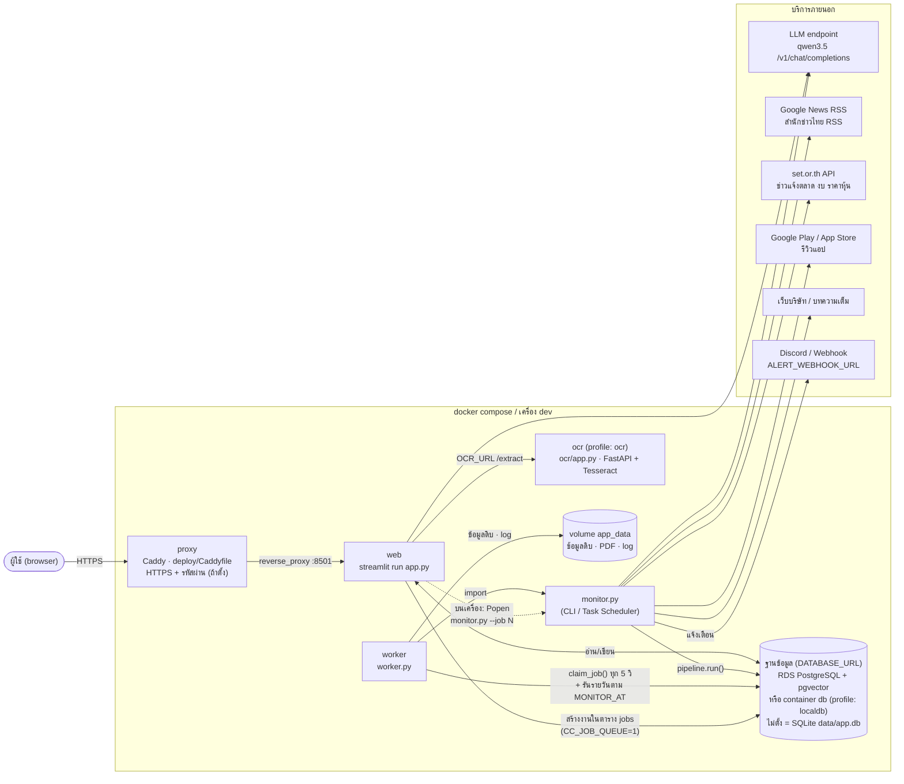
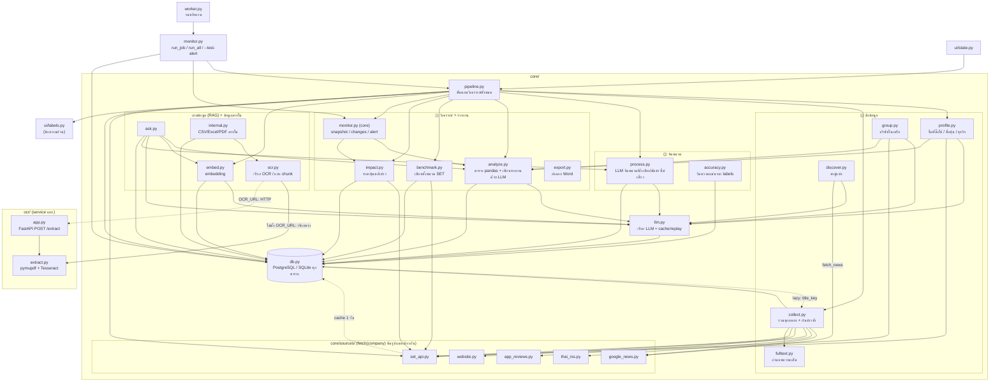
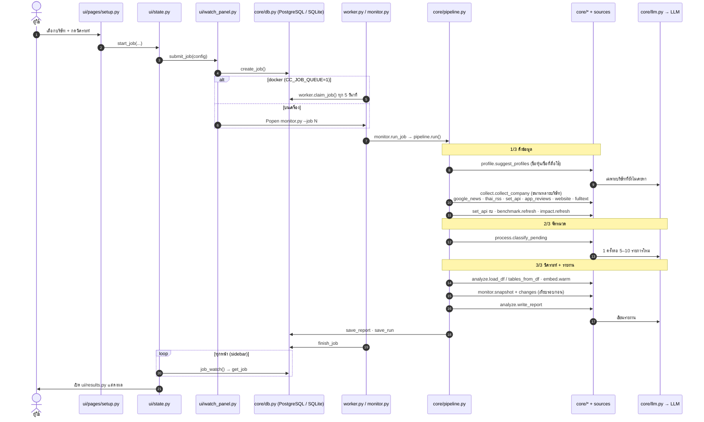

# System Flow

แผนภาพ flow ทั้งระบบ: ไฟล์ไหนเรียกไฟล์ไหน และหน้าที่ของแต่ละไฟล์/โฟลเดอร์
(สร้างจาก import จริงในโค้ด · รายละเอียดรายระบบดู [`architecture.md`](architecture.md) และ [`systems/`](systems/))

แบ่งเป็น 5 ภาพ:
1. [ภาพรวมการรัน (container / process / บริการภายนอก)](#1-ภาพรวมการรัน)
2. [ชั้น UI: หน้าเว็บเรียกอะไร](#2-ชั้น-ui-หน้าเว็บเรียกอะไร)
3. [ชั้น core: logic เรียกอะไร](#3-ชั้น-core-logic-เรียกอะไร)
4. [ลำดับการทำงานเมื่อกด "วิเคราะห์"](#4-ลำดับการทำงานเมื่อกด-วิเคราะห์)
5. [หน้าที่ของแต่ละไฟล์/โฟลเดอร์](#5-หน้าที่ของแต่ละไฟล์โฟลเดอร์)

---

## 1. ภาพรวมการรัน

มี 3 ทางเข้า (`app.py` หน้าเว็บ · `monitor.py` รันจาก command line / Task Scheduler · `worker.py` ใน docker)
ทุกทางใช้ `core/pipeline.py` ชุดเดียวกัน และแชร์ข้อมูลผ่านฐานข้อมูลเดียว: PostgreSQL (RDS หรือ container `db`) เมื่อตั้ง `DATABASE_URL` ไม่ตั้ง = SQLite

ภาพ: [PNG](diagrams/system-flow-1-runtime.png) · [SVG](diagrams/system-flow-1-runtime.svg)

---

## 2. ชั้น UI: หน้าเว็บเรียกอะไร

`app.py` → `ui/nav.py` สร้างเมนู → แต่ละหน้าใน `ui/pages/` เรียก panel/section ใน `ui/` → panel เรียก `core/`
(ไม่ได้วาดเส้นไป `core/db.py`, `ui/labels.py` และ `ui/common.py` เพราะเกือบทุกไฟล์ใช้)

```mermaid
flowchart TB
    app["app.py<br/>จุดเริ่มหน้าเว็บ"]
    nav["ui/nav.py<br/>เมนู"]
    state["ui/state.py<br/>สถานะร่วม + งานเบื้องหลัง"]

    subgraph sg_pages["ui/pages/ (1 ไฟล์ = 1 หน้า)"]
        direction LR
        p_overview["overview.py<br/>ภาพรวม"]
        p_setup["setup.py<br/>วิเคราะห์ใหม่"]
        p_ask["ask.py<br/>ถามข้อมูล"]
        p_companies["companies.py<br/>บริษัท/แหล่งข้อมูล"]
        p_internal["internal.py<br/>ข้อมูลภายใน"]
        p_watch["watch.py<br/>ติดตามอัตโนมัติ"]
        p_accuracy["accuracy.py<br/>ตรวจความแม่น"]
    end

    subgraph sg_panels["ui/ (panel)"]
        direction LR
        results["results.py<br/>หน้าผลลัพธ์"]
        company_picker["company_picker.py"]
        company_panel["company_panel.py"]
        group_panel["group_panel.py"]
        maintenance_panel["maintenance_panel.py"]
        internal_panel["internal_panel.py"]
        watch_panel["watch_panel.py"]
        accuracy_panel["accuracy_panel.py"]
    end

    subgraph sg_sections["ui/sections/ (แท็บในหน้าผล) + กราฟ"]
        direction LR
        s_ask["ask.py"]
        s_finance["finance.py"]
        s_market["market.py"]
        s_news["news.py"]
        charts["ui/charts.py"]
        insights["ui/insights.py"]
    end

    subgraph CORE["core/"]
        direction LR
        c_pipeline["pipeline"]
        c_discover["discover"]
        c_profile["profile"]
        c_collect["collect"]
        c_reviews["sources/app_reviews"]
        c_set["sources/set_api"]
        c_group["group"]
        c_process["process"]
        c_internal["internal"]
        c_ocr["ocr"]
        c_accuracy["accuracy"]
        c_analyze["analyze"]
        c_benchmark["benchmark"]
        c_impact["impact"]
        c_export["export"]
        c_ask["ask"]
        c_monitor["monitor"]
        c_llm["llm"]
    end

    monpy["monitor.py<br/>(process แยก)"]

    app --> nav & state
    nav --> sg_pages

    p_overview --> results
    p_setup --> company_picker & c_discover
    p_ask --> s_ask
    p_companies --> company_panel & group_panel & maintenance_panel
    p_internal --> internal_panel
    p_watch --> watch_panel
    p_accuracy --> accuracy_panel
    sg_pages -->|"ทุกหน้า (ยกเว้น accuracy)"| state

    state --> c_pipeline & c_analyze & c_collect & c_llm
    state --> group_panel & watch_panel
    state -.->|lazy import| results

    results --> s_finance & s_market & s_news & charts & insights & watch_panel
    results --> c_analyze & c_benchmark & c_collect & c_export & c_impact

    s_ask --> c_ask & c_benchmark & c_impact
    s_finance & s_market & s_news --> charts & insights
    s_market --> c_benchmark & c_impact
    s_news --> c_analyze

    watch_panel --> c_monitor
    watch_panel -.->|"subprocess.Popen / schtasks"| monpy
    company_panel --> c_collect & c_profile & c_reviews
    company_picker --> c_benchmark & c_profile & c_set
    group_panel --> c_group
    maintenance_panel --> c_process
    internal_panel --> c_internal & c_ocr & c_process
    accuracy_panel --> c_accuracy
```

ภาพ: [PNG](diagrams/system-flow-2-ui.png) · [SVG](diagrams/system-flow-2-ui.svg)

---

## 3. ชั้น core: logic เรียกอะไร

`core/pipeline.py` คือหัวใจ: รวม ดึงข้อมูล → จัดหมวด → เทียบรอบก่อน → เขียนรายงาน
ทุกไฟล์บันทึกลง `core/db.py` และทุกการเรียก LLM ผ่าน `core/llm.py` (ซึ่ง log ลง DB ด้วย)

ภาพ: [PNG](diagrams/system-flow-3-core.png) · [SVG](diagrams/system-flow-3-core.svg)

---

## 4. ลำดับการทำงานเมื่อกด "วิเคราะห์"

งานวิเคราะห์รันนอกหน้าเว็บเสมอ (หน้าเว็บไม่ค้าง) หน้าเว็บแค่อ่านความคืบหน้าจากตาราง `jobs`

ภาพ: [PNG](diagrams/system-flow-4-analyze-sequence.png) · [SVG](diagrams/system-flow-4-analyze-sequence.svg)

---

## 5. หน้าที่ของแต่ละไฟล์/โฟลเดอร์

### โฟลเดอร์

| โฟลเดอร์ | หน้าที่ |
|---|---|
| `/` (root) | จุดเริ่มทั้ง 3 ทาง (`app.py`, `monitor.py`, `worker.py`) + `migrate_to_postgres.py` + Dockerfile, compose, requirements, `DEPLOY.md` |
| `core/` | logic ทั้งหมด ไม่มี Streamlit: ดึงข้อมูล จัดหมวด วิเคราะห์ ฐานข้อมูล LLM |
| `core/sources/` | ตัวดึงข้อมูลแต่ละแหล่ง ทุกตัวมี `fetch(company, limit)` คืน dict รูปแบบเดียวกัน |
| `ui/` | หน้าเว็บ Streamlit: เมนู สถานะร่วม panel กราฟ |
| `ui/pages/` | 1 ไฟล์ = 1 หน้าในเมนู มี `render()` |
| `ui/sections/` | ส่วนย่อยของหน้าผลลัพธ์ (แท็บเจาะลึก / ถามข้อมูล) |
| `ocr/` | service อ่าน PDF แยก container (FastAPI + Tesseract ไทย) ใช้ร่วมกับแอปได้ |
| `data/` | ข้อมูลจริง: `app.db` (เมื่อใช้ SQLite), `raw/<บริษัท>/` ข้อมูลดิบที่ดึงมา, `last_run.json`, `monitor.log` |
| `demo/` | ชุดข้อมูลเดโมออฟไลน์ (`run_demo.bat` ชี้ `CC_DATA_DIR` มาที่นี่ + `LLM_REPLAY=1`) |
| `deploy/` | ไฟล์ขึ้นเซิร์ฟเวอร์จาก image บน Docker Hub (`docker-compose.yml`, `Caddyfile` ไม่มีรหัส, `Caddyfile.auth` มีรหัส) |
| `docs/` | เอกสาร: `architecture.md`, `systems/*.md` รายระบบ, `diagrams/*.html` แผนภาพ |
| `tests/` | pytest (ask, benchmark, citation, impact, monitor, ocr, หน้า UI, worker, SQL ทั้ง SQLite/PostgreSQL + ย้ายข้อมูล) · ตั้ง `TEST_DATABASE_URL` = รันกับ PostgreSQL |

### ไฟล์ทางเข้า

| ไฟล์ | หน้าที่ | เรียก |
|---|---|---|
| `app.py` | เปิดหน้าเว็บ: `init_db`, คืนผลล่าสุด, สร้างเมนู, แสดงความคืบหน้างานใน sidebar | `core.db`, `ui.nav`, `ui.state` |
| `monitor.py` | รันวิเคราะห์นอกหน้าเว็บ: `--job N` งานจากแอป, `--id N` ชุดติดตาม, ไม่ใส่ = ทุกชุด, `--test-alert` | `core.pipeline`, `core.monitor`, `core.db` |
| `worker.py` | container worker ใน docker: หยิบงาน `queued` ทุก 5 วิ + รันรายวันตาม `MONITOR_AT` | `monitor.py`, `core.db` |
| `migrate_to_postgres.py` | ย้ายข้อมูลจาก SQLite (`app.db`) ไป PostgreSQL ครั้งเดียว คง id เดิม | `core.db` |
| `run_demo.bat` | เปิดแอปโหมดเดโมออฟไลน์ | `streamlit run app.py` |

### `core/`

| ไฟล์ | หน้าที่ | LLM |
|---|---|---|
| `pipeline.py` | ขั้นตอนวิเคราะห์ครบชุด (ดึง → จัดหมวด → เทียบรอบก่อน → รายงาน) ใช้ทั้งแอปและ monitor | ผ่านไฟล์อื่น |
| `db.py` | ฐานข้อมูลทุกตาราง (PostgreSQL เมื่อตั้ง `DATABASE_URL` ไม่ตั้ง = SQLite) · pgvector คิดความใกล้: companies, documents, facts, reports, runs, jobs, watchlists, llm_log, embeddings, labels, cache | – |
| `llm.py` | เรียก `qwen3.5` · log ทุก call · `LLM_REPLAY` ใช้คำตอบเดิม · ล่มแล้วใช้ cache | ✔ |
| `collect.py` | ดึงจากทุกแหล่งของบริษัทหนึ่ง กันข่าวซ้ำ (`title_key`) บันทึกลง DB | – |
| `fulltext.py` | ถอดลิงก์ Google News แล้วอ่านบทความเต็มด้วย trafilatura | – |
| `profile.py` | หาชื่อที่สื่อใช้ ชื่อหุ้น SET และธุรกิจหลักของบริษัท | ✔ |
| `discover.py` | หาคู่แข่ง (ถาม LLM + ดึงชื่อจากข่าว → รวม → ตรวจหลักฐาน → จัดอันดับ) | ✔ |
| `group.py` | หาบริษัทในเครือ แล้วตรวจผู้ถือหุ้นใหญ่กับ SET | ✔ |
| `process.py` | จัดหมวด น้ำเสียง ตัดข่าวไม่เกี่ยว (ใช้ตัวอย่างจาก labels) | ✔ |
| `accuracy.py` | คำนวณความแม่นจากข่าวที่ผู้ใช้ตรวจแล้ว | – |
| `analyze.py` | สร้างตาราง pandas (หมวด, gap, รีวิว, งบ, ข้อมูลภายใน) + ให้ LLM เขียนรายงาน | ✔ |
| `benchmark.py` | อันดับ/เปอร์เซ็นไทล์เทียบทุกบริษัทในหมวดเดียวกันของ SET | – |
| `impact.py` | ราคาหุ้นหลังข่าว (abnormal return เทียบดัชนี) | – |
| `monitor.py` | snapshot ตัวเลขแต่ละรอบ เทียบรอบก่อน สร้างแจ้งเตือน ส่ง webhook | – |
| `export.py` | แปลงรายงาน markdown เป็นไฟล์ Word (ลิงก์กดได้) | – |
| `ask.py` | ถามข้อมูลแบบ RAG: LLM แปลงคำถามเป็นตัวกรอง → คัดข้อมูล → LLM ตอบพร้อม [n] | ✔ |
| `embed.py` | แปลงข้อความเป็นเวกเตอร์ (local sentence-transformers หรือ API) เก็บใน DB | (API) |
| `internal.py` | อ่านข้อมูลภายใน CSV/Excel และ PDF ที่อัปโหลด | – |
| `ocr.py` | อ่าน PDF: ส่งไป service `ocr` ถ้าตั้ง `OCR_URL` ไม่งั้นอ่านในแอป · แบ่ง chunk | – |

### `core/sources/`

| ไฟล์ | แหล่ง |
|---|---|
| `__init__.py` | รูปแบบ item กลาง, `SourceSkipped`, User-Agent |
| `google_news.py` | Google News RSS (feedparser) |
| `thai_rss.py` | RSS สำนักข่าวไทย + กรองตามชื่อบริษัท |
| `set_api.py` | API ภายในของ set.or.th: ข่าวแจ้งตลาด งบ ราคา ทะเบียนหุ้น (cache ใน DB 1 วัน) |
| `app_reviews.py` | รีวิว Google Play + App Store |
| `website.py` | เว็บบริษัท (เคารพ robots.txt) |

### `ui/`

| ไฟล์ | หน้าที่ |
|---|---|
| `nav.py` | ประกอบเมนู `st.navigation` · `go()` เปลี่ยนหน้า |
| `state.py` | สถานะร่วมทุกหน้า: ผลที่เปิดอยู่ ฟอร์ม เริ่ม/ติดตามงานเบื้องหลัง |
| `results.py` | หน้าผลลัพธ์: สิ่งที่ควรรู้ การ์ดบริษัท แท็บสรุป/เทียบ/เจาะลึก ดาวน์โหลด |
| `watch_panel.py` | ส่งงาน (`submit_job`: บนเครื่องเปิด `monitor.py` · docker ส่งเข้าคิว `jobs`), ชุดติดตาม, ตั้งเวลา Windows (`schtasks`) หรือแสดง `MONITOR_AT` ใน docker, แจ้งเตือน |
| `company_panel.py` | การ์ดแหล่งข้อมูลต่อบริษัท เปิด/ปิด/แก้ค่าแหล่ง |
| `company_picker.py` | รายชื่อบริษัทให้เลือก (เคยวิเคราะห์ + หุ้น SET/mai ทั้งหมด) |
| `group_panel.py` | เลือกบริษัทในเครือ |
| `maintenance_panel.py` | รวมบริษัทซ้ำ · จัดหมวดข่าวเก่าใหม่ |
| `internal_panel.py` | อัปโหลด CSV/Excel/PDF ภายใน |
| `accuracy_panel.py` | ผู้ใช้ตรวจข่าวทีละข่าว + แสดงความแม่น |
| `charts.py` | กราฟ Altair ทั้งหมด |
| `insights.py` | ประโยคอธิบายกราฟ คิดด้วย pandas |
| `labels.py` | ชื่อภาษาไทย คำอธิบายศัพท์ preset (ไม่มี streamlit — `core/pipeline.py` ใช้ด้วย) |
| `common.py` | helper: เวลา, แปลง error ให้อ่านง่าย |
| `pages/*.py` | หน้า: ภาพรวม · วิเคราะห์ใหม่ · ถามข้อมูล · บริษัท · ข้อมูลภายใน · ติดตาม · ตรวจความแม่น |
| `sections/*.py` | แท็บย่อย: ถามข้อมูล · งบการเงิน · ตลาด/ราคาหุ้น · ข่าว/รีวิว/แนวโน้ม |

### `ocr/`

| ไฟล์ | หน้าที่ |
|---|---|
| `app.py` | FastAPI `POST /extract` รับ PDF คืนข้อความทีละหน้า |
| `extract.py` | ใช้ข้อความในไฟล์ก่อน (pymupdf) ถ้าไม่มี/เพี้ยนค่อย OCR (Tesseract `tha+eng`) |
| `Dockerfile` | image `competitor-ocr` ที่มี Tesseract ภาษาไทย |
