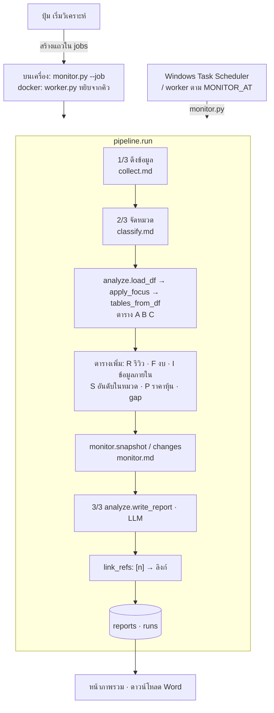

# ระบบวิเคราะห์ เขียนรายงาน และงานเบื้องหลัง

ขั้นที่ 3 ของการวิเคราะห์: นำ facts ที่จัดหมวดแล้วมาคิดเป็นตารางด้วย pandas แล้วให้ LLM เขียนรายงานภาษาไทยจากตารางนั้น
พร้อมเลขอ้างอิง `[n]` ที่ลิงก์ไปยังข่าวหรือหน้างบต้นทาง ไฟล์นี้อธิบาย `pipeline.run` ทั้งเส้นด้วย และวิธีรันเบื้องหลังเพื่อไม่ให้หน้าเว็บค้าง

## ภาพรวม

หลักสำคัญคือ **LLM ไม่นับหรือคำนวณเอง** ทุกตัวเลขคิดด้วย pandas ก่อน LLM ได้รับตารางที่คิดเสร็จแล้ว และมีหน้าที่แค่เขียนเป็นภาษาคน
ทุกแถวที่มาจากข่าวหรืองบมีเลข ref ให้ LLM อ้าง ระบบแปลงเลขเป็นลิงก์ และต่อท้ายเฉพาะแหล่งที่ถูกอ้างจริง ผู้อ่านจึงกดตรวจได้ทุกข้อ

ดูแบบโต้ตอบ (archify): [analysis-pipeline.html](../diagrams/analysis-pipeline.html) · [background-job.html](../diagrams/background-job.html)

## ขั้นตอน (`pipeline.run`)

1. **ดึงข้อมูล** ([`collect.md`](collect.md)) และถ้าเปิดแหล่ง "งบการเงิน (SET)" จะดึงงบ ตัวเลขทั้งหมวด และราคาหุ้นด้วย ([`market.md`](market.md))
2. **จัดหมวด** ([`classify.md`](classify.md))
3. **โหลดและกรอง:** `analyze.load_df` (facts ที่ไม่ใช่ `irrelevant`) → คำนวณเวกเตอร์ล่วงหน้าให้แท็บถาม (`embed.warm`) → `apply_focus`
   - ถ้าเลือกหมวดที่สนใจ เก็บเฉพาะข่าวในหมวดนั้น (รีวิวไม่ถูกกรองด้วยหมวด)
   - ถ้าใส่คำค้น ทุกรายการต้องมีคำค้นในหัวข้อ สรุป หรือเนื้อหา
4. **ตาราง A/B/C** (`tables_from_df`) คิดจากข่าว + เว็บบริษัทเท่านั้น (`news_only` ตัดรีวิวและ PDF ที่อัปโหลด)
   ถ้าตาราง A ว่างจะหยุดและแจ้งว่า "ไม่พบข่าวของบริษัทที่เลือก"
5. **ตารางประกอบ** (ด้านล่าง) + เทียบกับรอบก่อน ([`monitor.md`](monitor.md))
6. **เลือกแบบรายงาน:** ไม่มีบริษัทเรา = `phase1` · มีบริษัทเรา = `phase2` (หรือ `phase3` ถ้ามาจากโหมดหาคู่แข่ง)
   ถ้ามีบริษัทเราแต่ตาราง gap ว่าง (ไม่มีข่าวของเราหรือของคู่แข่ง) จะถอยไปเขียนแบบ `phase1` และแจ้งผู้ใช้
7. **เขียนรายงาน** (`write_report`) → บันทึก `reports`
8. **บันทึกรอบ** `runs`: config, snapshot, changes, report_id และต้นทุน LLM ของรอบ (`db.llm_stats(since=เวลาเริ่ม)` = จำนวน call และวินาทีรวม)
   เวลาของรอบคือเวลาจบ ข่าวที่ดึงในรอบนี้จึงไม่ถูกนับเป็น "ใหม่" ในรอบถัดไป

### ตาราง

| ตาราง | ฟังก์ชัน | เนื้อหา |
|---|---|---|
| A | `tables_from_df` | จำนวนข่าว บริษัท × หมวด + แถว/คอลัมน์รวม |
| B | `tables_from_df` | % น้ำเสียง (positive/neutral/negative) ต่อบริษัท |
| C | `tables_from_df` | ข่าวล่าสุด 5 รายการต่อบริษัท (ใช้ `summary`) + ref |
| R | `review_table` | ต่อบริษัท: จำนวนรีวิว ดาวเฉลี่ย (รวมและแยกสโตร์) % รีวิวบวก/ลบ |
| F | `financial_table` | งบล่าสุด รายได้/กำไรโต อัตรากำไร ROE D/E มูลค่าตลาด P/E ปันผล · ธนาคารเพิ่ม NII NIM (ประมาณ) cost to income credit cost LDR (`bank_metrics`) |
| I | `internal_table` | ข้อมูลภายในที่อัปโหลด บริษัท × ตัวชี้วัด (ส่งเมื่อเปิดสวิตช์ "ให้ LLM ใช้ข้อมูลภายใน") |
| S | `benchmark.table` | อันดับในหมวดธุรกิจ SET ทั้งหมวด |
| P | `impact.events` | วันที่หุ้นขยับผิดปกติหลังข่าว (ส่งให้ LLM ไม่เกิน 8 แถว) |
| gap | `gap_table` | ของเรา − ค่าเฉลี่ยคู่แข่ง: หมวด (% ของข่าว), น้ำเสียง, รีวิว (ดาว, % ลบ), การเงิน (`FINANCE_GAP_ITEMS` = รายได้โต อัตรากำไรสุทธิ ROE), ข้อมูลภายใน · บริษัทในเครือไม่นับเป็นคู่แข่ง |

### อ้างอิง `[n]`

- `write_report` ใส่คอลัมน์ `ref` ให้แถวใน Table C, F, S, P และ Changes แล้วเก็บ `(ชื่อ, url)` ไว้ในลำดับเดียวกัน
- `link_refs` แปลง `[3]`, `[1, 2]`, `[6-10]` และรูปแบบที่ LLM ชอบเขียนเอง เช่น `[Table C: ref 11-15]`, `[ref 2]` (regex `REF`) เป็นลิงก์
- ตัดการอ้างชื่อตาราง เช่น `[Table F]`, `[Gap table]` ทิ้ง (`TABLE_CITE`) เพราะผู้อ่านเปิดดูไม่ได้
- เลขที่เกินจำนวน ref ไม่ถูกแปลง
- ต่อท้ายรายการ "แหล่งอ้างอิง" เฉพาะเลขที่ถูกอ้างจริง
- url ที่ไม่ใช่ http (PDF ที่อัปโหลด `upload://`) แสดงเป็นข้อความ ไม่ทำลิงก์ (`_linkable`)

### ส่วนอื่นในหน้าผล (ไม่ใช้ LLM)

- **สิ่งที่ควรรู้** (`ui/results.key_points`): ไม่เกิน 5 ข้อ เรียงตามนี้
  - เรื่องสำคัญที่เปลี่ยนจากรอบก่อน
  - อันดับเด่นในหมวดธุรกิจ (`benchmark.highlights`)
  - วันที่หุ้นขยับผิดปกติหลังข่าว (2 รายการแรก)
  - เรื่องที่บริษัทเราต่างจากค่าเฉลี่ยคู่แข่งมากที่สุด (น้ำเสียง/การเงิน/รีวิว)

  ส่วนประโยคสรุปในแต่ละแท็บสร้างโดย `ui/insights.py`
- **ตัวกรอง** (`ui/results.apply_filters`): กรองบริษัท แหล่ง ช่วงเวลา หมวด น้ำเสียง คำค้น แล้วคิดตารางใหม่ด้วย `tables_from_df`
  มีปุ่มเขียนรายงานใหม่ตามตัวกรอง (`rewrite_report` → `write_report` 1 ครั้ง)
- **ดาวน์โหลด:** Word (`export.report_docx` ฟอนต์ Tahoma ลิงก์อ้างอิงกดได้) · Markdown · CSV ของข้อมูลที่กรองแล้ว

## งานเบื้องหลัง

กด "เริ่มวิเคราะห์" แล้วหน้าเว็บไม่ค้าง เพราะงานถูกส่งไปรันใน process แยก:

1. `ui/state.start_job` ทำขั้นที่ต้องโต้ตอบในหน้าเว็บก่อน (บันทึกบริษัท หาบริษัทในเครือ) แล้ว `db.create_job` สร้างแถวใน `jobs` สถานะ `running`
2. บนเครื่อง: `watch_panel.start_background("--job", id)` เปิด `monitor.py --job <id>` ด้วย `pythonw` (ไม่มีหน้าต่าง) ส่ง environment เดิมไปด้วย
   ใน docker (`CC_JOB_QUEUE=1`): `submit_job` สร้างแถวสถานะ `queued` แทน แล้ว `worker.py` หยิบ (`db.claim_job` ทุก 5 วินาที) · worker ถูกรีสตาร์ทกลางงาน = งานนั้นเป็น `error`
3. `monitor.run_job` เรียก `pipeline.run` โดย log แต่ละบรรทัดลง `jobs.log` ในรูป `kind|ข้อความ`
4. ใน sidebar ทุกหน้า `state.job_watch` (fragment ทุก 2 วินาที) อ่าน `jobs` แสดงเวลาและสถานะล่าสุด หน้าภาพรวมแสดง log เต็ม (`job_progress`)
5. จบแล้ว `finish_job` ตั้งสถานะ `done`/`error` → `job_watch` เปิดผลให้เอง (`open_run`) ไม่ว่าผู้ใช้อยู่หน้าไหน

ข้อยกเว้น: โหมดหาคู่แข่งรันในหน้าเว็บ (`state.run_pipeline`) เพราะผู้ใช้ต้องติ๊กยืนยันรายชื่อก่อน
บน cloud ส่วนนี้จะเปลี่ยนเป็น worker หยิบงาน `queued` (ดู [`huawei-cloud.md`](../huawei-cloud.md))

## LLM

| จุด | ครั้ง | ส่งอะไร | ตรวจคำตอบ |
|---|---|---|---|
| `write_report` | 1 ครั้งต่อรอบ (+1 ถ้าคำตอบมีอักษรจีน) | prompt ตามแบบ phase1 (เทียบกลาง ๆ ไม่เกิน 300 คำ) หรือ phase2/3 (ที่ปรึกษาของบริษัทเรา 5 หัวข้อ ไม่เกิน 400 คำ) + ตารางที่มี + ขอบเขตที่กรอง + กฎการอ้างอิง | มีอักษรจีน (`CJK`) ให้เขียนใหม่ 1 ครั้ง แล้วตัดอักษรจีนที่เหลือทิ้ง · เลขอ้างอิงที่ไม่มีจริงไม่ถูกแปลง |
| `rewrite_report` (ปุ่มในหน้าผล) | 1 ครั้งต่อการกด | เหมือนข้างบน แต่ใช้ตารางที่กรองแล้ว | เหมือนข้างบน |

## ข้อมูลที่อ่าน/เขียน

| ตาราง | อ่าน/เขียน | ใช้ทำอะไร |
|---|---|---|
| `facts` + `documents` + `companies` | อ่าน | `db.facts_df` |
| `financials`, `internal_metrics`, `market_cache` | อ่าน | ตาราง F, I, S, P |
| `reports` | เขียน | ข้อความรายงาน (markdown ที่แปลงลิงก์แล้ว) + `mode` |
| `runs` | เขียน | 1 แถวต่อรอบ (ใช้เปิดผลย้อนหลังและเทียบรอบถัดไป) |
| `jobs` | อ่าน + เขียน | สถานะและ log ของงานเบื้องหลัง |
| `data/last_run.json` | เขียน | ผลที่เปิดอยู่ล่าสุด เปิดแอปใหม่แล้วกลับมาที่เดิม (`state.remember`) |

## ค่าที่ปรับได้

| ค่า | ที่ | ปัจจุบัน |
|---|---|---|
| ค่าเริ่มต้นของการวิเคราะห์ | `pipeline.DEFAULT_OPTS` | Google News, 20 ข่าว, 20 รีวิว, ไม่ดึงเนื้อหาเต็ม, ไม่ดึงงบ, ใช้ข้อมูลภายใน |
| ความยาวรายงานและหัวข้อ | `analyze.REPORT_PROMPT` / `REPORT_PROMPT_SELF` | 300 / 400 คำ |
| ตัวชี้วัดการเงินในตาราง gap | `analyze.FINANCE_GAP_ITEMS` | รายได้โต อัตรากำไรสุทธิ ROE |
| ข่าวล่าสุดต่อบริษัทใน Table C | `tables_from_df` (`head(5)`) | 5 |
| ความถี่ที่หน้าเว็บอ่านสถานะงาน | `state.job_watch` (`run_every=2`) | 2 วินาที |

## เมื่อมีปัญหา

- **ไม่มีข่าวเลย หรือไม่มีข่าวในเรื่องที่สนใจ:** หยุดก่อนเขียนรายงาน แจ้ง error (ไม่เรียก LLM ขั้นรายงาน)
- **มีบริษัทเราแต่เทียบไม่ได้:** เขียนแบบ phase1 แทน และแจ้งในแถบสถานะ
- **LLM หลุดภาษาจีน:** เขียนใหม่ 1 ครั้ง แล้วตัดอักษรจีนทิ้ง
- **LLM อ้างเลขที่ไม่มี หรืออ้างชื่อตาราง:** เลขที่ไม่มีคงไว้เป็นข้อความ ส่วนชื่อตารางถูกตัด
- **งานเบื้องหลังพัง:** `run_job` จับ exception แล้วบันทึก error ลง `jobs` หน้าเว็บจึงแสดง error แทนการรอไปเรื่อย ๆ · traceback อยู่ใน `data/monitor.log` · รอเกิน 15 นาทีมีปุ่ม "เลิกรอ"

## สำหรับนักพัฒนา

| ไฟล์ | ฟังก์ชัน | หน้าที่ |
|---|---|---|
| `core/pipeline.py` | `run`, `DEFAULT_OPTS` | ลำดับขั้นทั้งหมด ใช้ร่วมกันระหว่างแอปและ `monitor.py` |
| `core/analyze.py` | `load_df`, `apply_focus`, `tables_from_df`, `news_only`, `review_table`, `financial_table`, `bank_metrics`, `internal_table`, `gap_table`, `write_report`, `link_refs` | ตารางและรายงาน |
| `core/export.py` | `report_docx` | Word |
| `monitor.py` | `run_job` | รันงานเบื้องหลัง |
| `ui/state.py` | `start_job`, `job_watch`, `job_progress`, `build_result`, `open_run` | ฝั่งหน้าเว็บ |
| `ui/results.py`, `ui/insights.py` | `key_points`, `apply_filters`, `rewrite_report` | หน้าผล |

- **เพิ่มตารางใหม่ให้รายงาน:** คิดตารางใน `analyze` → เพิ่ม `*_SECTION` ใน prompt → ต่อใน `write_report` (ถ้ามีที่มา ใส่ `ref` ด้วย `add_ref` และเพิ่มชื่อใน `CITE_RULE`) → ส่งจาก `pipeline.run` และ `ui/results.rewrite_report`
- **เทส:** `tests/test_citations.py` (การแปลงเลขอ้างอิงทุกรูปแบบ) · `test_docx_has_clickable_citation` · `test_link_refs_upload_is_plain_text` · `test_uploaded_docs_not_counted_as_news` · `tests/test_ui_pages.py` (เปิดทุกหน้ากับชุดเดโม)
