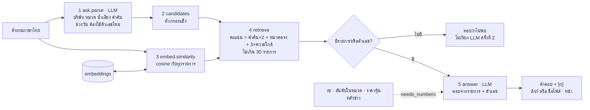

# ระบบถามข้อมูล (RAG)

แท็บ/เมนู "ถามข้อมูล": ผู้ใช้ถามเป็นภาษาไทย เช่น "AP เปิดโครงการใหม่อะไรบ้าง" ระบบตอบจากข้อมูลที่เก็บไว้เท่านั้น
ทุกข้อมีเลขอ้างอิง และถ้าไม่มีข้อมูลจะตอบว่าไม่พบ ไม่ใช้ความรู้ของ LLM เอง

## ภาพรวม

ต่างจากการถาม LLM ตรง ๆ ตรงที่ LLM เห็นแค่รายการที่ระบบคัดมาให้ จึงตอบได้เฉพาะเรื่องที่มีหลักฐาน และบอกได้ว่าแต่ละข้อมาจากไหน
การคัดรายการใช้ทั้ง **คำค้น** (แม่นเมื่อคำตรง) และ **ความหมาย** (embedding: ถาม "เน็ตบ้าน" เจอข่าว "บรอดแบนด์")
แล้วรวมเป็นคะแนนเดียว (hybrid search)

ขอบเขตคือบริษัทในผลวิเคราะห์ที่เปิดอยู่ (`res["df"]`) ซึ่งรวมข่าว ประกาศ SET รีวิว เว็บบริษัท และ PDF ที่อัปโหลด

ดูแบบโต้ตอบ (archify): [ask-rag.html](../diagrams/ask-rag.html)

## ขั้นตอน (`ask.answer`)

1. **แปลงคำถามเป็นตัวกรอง** (`parse`, LLM ครั้งที่ 1) ส่งรายชื่อบริษัทพร้อมชื่อเรียกไม่เกิน 3 ชื่อ (เช่น บาร์บีคิวพลาซ่า → ฟู้ดแพชชั่น) ได้กลับมาเป็น:
   - `companies` จากรายชื่อเท่านั้น (ชื่อที่ไม่มีถูกทิ้ง ไม่สนตัวพิมพ์)
   - `categories` และ `sentiments` ที่อยู่ในชุดที่ถูกต้อง
   - `keywords` ไม่เกิน 6 คำ ห้ามคำทั่วไปอย่าง "ข่าว" "โปร" "ล่าสุด" เพราะหมวด/น้ำเสียงครอบคลุมแล้ว
   - `days` และ `needs_numbers`
   - LLM ตอบไม่เป็น JSON = ใช้ตัวกรองว่าง (ค้นทุกอย่าง)
2. **ตัวกรองแข็ง** (`candidates`): ตัด `irrelevant` → กรองบริษัท → ช่วงวัน → น้ำเสียง
   ในโหมดเดโมนับวันจากข่าวล่าสุดในชุดข้อมูลแทนวันนี้ (`CC_DEMO`) เพราะชุดเดโมไม่ได้อัปเดต
3. **ความใกล้ทางความหมาย** (`embed.similarity`): cosine ของคำถามกับ "หัวข้อ + สรุป" ของทุกรายการ
   รายการที่หัวข้อสั้นกว่า 10 ตัว (`MIN_TITLE` เช่น รีวิว "." "ห่วยแตก") ได้ 0 เพราะใกล้กับทุกคำถาม · ใช้ไม่ได้ = `None`
4. **คัดและเรียง** (`retrieve`) ไม่เกิน 30 รายการ (`MAX_ROWS`):
   - **มีคำค้น:** รายการต้องมีคำค้นอย่างน้อย 1 คำ (ในหัวข้อ สรุป หรือเนื้อหา) **หรือ** ใกล้ทางความหมายพอ (`_close`)
     คะแนน = จำนวนคำค้นที่เจอ × 2 + หมวดตรง 1 + 3 × ความใกล้ (`SIM_WEIGHT`) แล้วเรียงตามคะแนนและความใหม่
   - **ใกล้พอ** (`_close`): ความใกล้ ≥ ค่ากลางของทุกรายการ + 0.05 (`SIM_MARGIN`) และห่างจากรายการที่ใกล้ที่สุดไม่เกิน 0.03 (`SIM_GAP`)
     ใช้ระยะจากค่ากลางแทนค่าตายตัว เพราะ e5-small ให้ cosine ราว 0.8 กับแทบทุกข่าวไทย
   - **กฎแบรนด์ที่ไม่มีในระบบ:** คำค้นมีตัวพิมพ์ใหญ่ (เช่น Shopee) และไม่ได้ระบุบริษัท ถ้าคำค้นไม่เจอเลย จะไม่ใช้รายการที่ "ความหมายคล้าย" ของบริษัทอื่นมาตอบ
   - **คำค้นไม่เจอแต่มีหมวด/น้ำเสียง:** ใช้หมวด/น้ำเสียงแทน (LLM อาจสะกดคำค้นไม่ตรงข่าว)
   - **ไม่มีคำค้นและไม่ระบุหมวด:** เรียงตามความหมาย
   - **ที่เหลือ:** กรองตามหมวด เรียงตามความใหม่
5. **ตัวเลข** (เมื่อ `needs_numbers`): เพิ่มตารางงบ (Table F) อันดับในหมวด และราคาหุ้นหลังข่าว (ไม่เกิน 10 แถว) ของบริษัทในขอบเขต แต่ละส่วนมีเลข ref ไปหน้า SET/ข่าว
6. **ไม่มีทั้งรายการและตัวเลข:** ตอบว่า "ไม่พบข้อมูลในระบบ..." โดยไม่เรียก LLM ครั้งที่ 2
7. **เขียนคำตอบ** (LLM ครั้งที่ 2) แล้ว `analyze.link_refs` แปลงเลขเป็นลิงก์ (PDF ที่อัปโหลดแสดงเป็น "ชื่อไฟล์ · หน้า x" ไม่มีลิงก์) และตัดอักษรจีน

หน้าเว็บแสดงใต้คำตอบว่าใช้กี่รายการ ค้นจากอะไร ค้นด้วยความหมายได้ไหม และเรียก LLM กี่ครั้ง ประวัติคำถามเก็บต่อผลวิเคราะห์ใน session

### Embedding (`core/embed.py`)

| | |
|---|---|
| โมเดล | `intfloat/multilingual-e5-small` (384 มิติ) ผ่าน `sentence-transformers` บน CPU โหลดครั้งแรก ~470 MB · ใส่คำนำ `query:` / `passage:` ตามที่ e5 ต้องการ |
| ข้อความ | หัวข้อ + สรุป ไม่เกิน 500 ตัว |
| cache | ตาราง `embeddings` key = sha256(โมเดล + ชนิด + ข้อความ) เก็บ float32 ที่ normalize แล้ว (cosine = dot) ข้อความเดิมไม่คำนวณซ้ำ |
| คำนวณล่วงหน้า | `embed.warm` ตอนวิเคราะห์เบื้องหลัง คำถามแรกจึงไม่ช้า |
| backend | `EMBED_BACKEND=local` (ค่าเริ่ม) หรือ `api` (เรียก `/v1/embeddings` ของ endpoint LLM ใช้เมื่อมีโมเดล embedding · ตอนนี้ key ใช้ได้แค่ qwen3.5) · เปลี่ยนโมเดลด้วย `EMBED_MODEL` |

## LLM

| จุด | ครั้ง | ส่งอะไร | ตรวจคำตอบ |
|---|---|---|---|
| `parse` | 1 ต่อคำถาม | รายชื่อบริษัท + ชื่อเรียก + หมวด + คำถาม ขอ JSON ตัวกรอง | ทุกค่าถูกกรองให้อยู่ในชุดที่ถูกต้อง · ไม่ใช่ JSON = ตัวกรองว่าง |
| `answer` | 0–1 ต่อคำถาม | ตารางรายการ (ref, บริษัท, วันที่, แหล่ง, หมวด, น้ำเสียง, หัวข้อ 160 ตัว, สรุป) + ตัวเลข สั่งให้ใช้แต่ข้อมูลนี้ ตอบไทยไม่เกิน ~200 คำ ใส่ [n] ทุกข้อ ไม่มีข้อมูลให้บอกว่าไม่พบ · rank 1 = ดีที่สุดในหมวด | `link_refs` แปลงเฉพาะเลขที่มีจริง · ตัดชื่อตาราง · ตัดอักษรจีน |

embedding ไม่นับเป็นการเรียก LLM

## ข้อมูลที่อ่าน/เขียน

| ที่ | อ่าน/เขียน | ใช้ทำอะไร |
|---|---|---|
| `res["df"]` (จาก `facts_df` ตอนเปิดผล) | อ่าน | รายการที่ค้นได้ |
| `companies` | อ่าน | ชื่อเรียก (ใน `parse`) |
| `embeddings` | อ่าน + เขียน | เวกเตอร์ |
| `financials`, `market_cache` | อ่าน | ตัวเลขงบ อันดับ ราคา |
| `llm_log` | เขียน | ทุก call (คำถามตัวอย่างในโหมดเดโมจึงตอบได้แม้ไม่มีเน็ต) |

## ค่าที่ปรับได้

| ค่า | ที่ | ปัจจุบัน |
|---|---|---|
| รายการสูงสุดที่ส่ง LLM | `ask.MAX_ROWS` | 30 |
| ระยะจากค่ากลาง / ห่างจากรายการที่ใกล้สุด | `ask.SIM_MARGIN` / `SIM_GAP` | 0.05 / 0.03 |
| น้ำหนักความหมายในคะแนน | `ask.SIM_WEIGHT` | 3 |
| หัวข้อสั้นกว่านี้ไม่ใช้ความหมาย | `embed.MIN_TITLE` | 10 ตัว |
| backend / โมเดล | env `EMBED_BACKEND`, `EMBED_MODEL` | local / multilingual-e5-small |
| ชื่อแหล่งในคำตอบ | `ask.SOURCES` | ข่าว เว็บไซต์บริษัท ประกาศ SET รีวิวแอป เอกสารที่อัปโหลด |

ค่า `SIM_MARGIN` / `SIM_GAP` ทดสอบกับข่าว AIS/True/NT/3BB/DTAC 324 รายการ (ตามคอมเมนต์ในโค้ด) เปลี่ยนโมเดลแล้วควรปรับใหม่

## เมื่อมีปัญหา

- **ไม่ได้ลง `sentence-transformers` / โหลดโมเดลไม่ได้ / API embedding ล่ม:** `similarity` คืน `None` ค้นด้วยคำค้นอย่างเดียว หน้าเว็บบอกว่า "ค้นด้วยคำค้นอย่างเดียว"
- **LLM แปลงคำถามไม่ได้:** ใช้ตัวกรองว่าง ค้นจากทุกบริษัท
- **ถามแบรนด์ที่ไม่มีในระบบ:** ตอบว่าไม่พบ แทนการเอาข่าวบริษัทอื่นมาตอบ
- **LLM ล่มตอนเขียนคำตอบ:** ใช้คำตอบเดิมของ prompt เดียวกันถ้าเคยถาม (ดู [`platform.md`](platform.md)) ไม่งั้นแสดง error แบบอ่านง่าย (`ui/common.friendly_errors`)

## สำหรับนักพัฒนา

| ไฟล์ | ฟังก์ชัน | หน้าที่ |
|---|---|---|
| `core/ask.py` | `parse`, `candidates`, `_close`, `retrieve`, `answer`, `PARSE_PROMPT`, `ANSWER_PROMPT` | เส้นทางถาม |
| `core/embed.py` | `vectors`, `similarity`, `warm`, `_local`, `_api` | embedding + cache |
| `ui/sections/ask.py` | `tab_ask`, `_examples` | หน้าถาม คำถามตัวอย่าง ประวัติ |

- **บน cloud:** เปลี่ยน cache `embeddings` + numpy เป็น pgvector (`ORDER BY vec <=> :q`) ดู [`huawei-cloud.md`](../huawei-cloud.md) ข้อ 2
- **เทส** (`tests/test_ask_internal_misc.py`):
  - `test_keyword_hit_ranks_first`
  - `test_sentiment_filter_and_irrelevant_excluded`
  - `test_unknown_brand_gives_nothing_but_known_company_falls_back_to_category`
  - `test_semantic_match_without_keyword_hit`
  - `test_semantic_never_answers_unknown_brand_with_other_companies`
  - `test_similarity_caches_and_falls_back`
