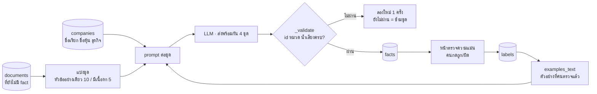

# ระบบจัดหมวด ตรวจความเกี่ยวข้อง และตรวจความแม่น

ขั้นที่ 2 ของการวิเคราะห์: ให้ LLM อ่านทุกรายการใหม่ใน `documents` แล้วบอกว่าเป็นเรื่องของบริษัทนั้นจริงไหม อยู่หมวดอะไร
น้ำเสียงต่อบริษัทเป็นบวก/กลาง/ลบ และสรุปเป็นภาษาไทย 1 ประโยค ผลเก็บในตาราง `facts`
ส่วนตรวจความแม่นให้คนกดตรวจผลของ LLM เพื่อวัดเป็นตัวเลข และป้อนตัวอย่างกลับเข้า prompt

## ภาพรวม

ข่าวที่ค้นด้วยชื่อมักได้เรื่องอื่นปนมา เช่น "ซอย AP", พิธีกร "MC", สำนักข่าว "AP" หรือรายชื่อหุ้นเด่นประจำวัน
แทนที่จะเรียก LLM อีกรอบเพื่อกรอง ระบบให้ LLM ตอบ `relevant` มาในคำตอบเดียวกับการจัดหมวด
รายการที่ไม่เกี่ยวยังถูกเก็บเป็น fact หมวด `irrelevant` เพื่อไม่ส่งให้ LLM ซ้ำ แต่ไม่ถูกนำไปวิเคราะห์

ทุกรายการถูกส่ง LLM ครั้งเดียว (รายการที่มี fact แล้วไม่ถูกส่งซ้ำ) และส่งเป็นชุดหลายรายการต่อ 1 ครั้ง เพื่อให้เรียก LLM น้อยที่สุด

ดูแบบโต้ตอบ (archify): [classify.html](../diagrams/classify.html)

## ขั้นตอน (`process.classify_pending`)

1. ดึง `documents` ที่ยังไม่มีใน `facts` ของบริษัทที่วิเคราะห์ (`db.unprocessed_documents`)
2. แยกตามบริษัท แล้วแบ่งชุด: รายการที่มีแค่หัวข้อ ชุดละ 10 (`BATCH_SIZE`) · มีเนื้อหาหรือเป็นรีวิว ชุดละ 5 (`BATCH_SIZE_CONTENT`) เพราะ prompt ยาวกว่า
3. เตรียมข้อมูลบริษัทให้ LLM แยกจากสิ่งอื่นที่ชื่อเหมือนกัน (`describe`): ชื่อ + ชื่อเรียก + ชื่อหุ้น + ธุรกิจหลัก
4. เตรียมตัวอย่างจากคนตรวจ (`examples_text`): ไม่เกิน 6 รายการ เน้นรายการที่ระบบเคยตัดสินผิด และรายการของบริษัทนี้ก่อน (`db.label_examples`)
5. แต่ละรายการเป็น 1 บรรทัด `id [ชนิดแหล่ง]: หัวข้อ` ตามด้วยเนื้อหาไม่เกิน 600 ตัว (`CONTENT_CHARS`, `_line`)
6. ส่ง LLM พร้อมกัน 4 ชุด (`LLM_WORKERS`) แล้วบันทึกผลตามลำดับในเธรดหลัก
7. ตรวจคำตอบ (`_validate`): ต้องเป็น JSON array · `id` ต้องตรงกับที่ส่งไปครบทุกตัว · `category` ต้องอยู่ใน 7 หมวด · `sentiment` ต้องเป็น 1 ใน 3 ค่า ไม่ผ่านให้ลองใหม่ 1 ครั้ง ยังไม่ผ่านจะข้ามทั้งชุด
8. บันทึก `facts`: ถ้า `relevant` เป็น false **และ** แหล่งเป็นแบบค้นด้วยชื่อ (`CHECKED_SOURCES` = news, rss) ให้ใช้หมวด `irrelevant` · แหล่งอื่น (เว็บบริษัท ข่าว SET รีวิว PDF ที่อัปโหลด) ถือว่าเกี่ยวเสมอ
9. คืน `(บันทึก, ชุดที่ข้าม, ตัดออก)` ให้ pipeline แสดงผล

หมวด (`CATEGORIES`): `product_price` · `promotion` · `news_pr` · `review` (รีวิวแอปทุกรายการ) · `financial` · `hr` · `other`
ชื่อไทยของหมวดอยู่ใน `ui/labels.py` (`CATEGORY_TH`)

## ตรวจความแม่น (หน้า "ตรวจความแม่น")

- **คิวตรวจ** (`db.label_queue`): สุ่มครั้งละ 20 ข่าว (`ui/accuracy_panel.QUEUE`) เฉพาะแหล่งที่ค้นด้วยชื่อ (news, rss) ที่ยังไม่ได้ตรวจ
  ราว 1/3 เป็นข่าวที่ระบบตัดออก เพื่อให้วัดได้ทั้งสองฝั่ง (ข่าวที่ตัดออกมีน้อย ถ้าสุ่มตามสัดส่วนจริงจะแทบไม่เจอ)
- คนกด "เกี่ยว" (แก้หมวด/น้ำเสียงได้) หรือ "ไม่เกี่ยว" → `db.save_label` ลงตาราง `labels`
- **ตัวเลข** (`accuracy.metrics`) แสดงเมื่อแต่ละกลุ่มมีอย่างน้อย 5 ตัวอย่าง (`MIN_LABELS`):

| ตัวเลข | คิดยังไง |
|---|---|
| ข่าวที่เก็บไว้เกี่ยวจริง (`kept_ok`) | ในข่าวที่ระบบเก็บ คนบอกว่าเกี่ยวกี่ % |
| ข่าวที่ตัดออกไม่เกี่ยวจริง (`dropped_ok`) | ในข่าวที่ระบบตัด คนบอกว่าไม่เกี่ยวกี่ % |
| จับข่าวไม่เกี่ยวได้ (`recall`) | ประมาณจากสัดส่วนจริงในฐานข้อมูล (`db.label_population`) เพราะคิวดึงข่าวที่ตัดออกมาเกินสัดส่วน: จับได้ = `dropped_ok` × จำนวนที่ตัด · หลุด = (1 − `kept_ok`) × จำนวนที่เก็บ |
| หมวด / น้ำเสียงถูก | เฉพาะข่าวที่เกี่ยวจริงและคนระบุหมวด/น้ำเสียงไว้ |

- **รายการที่ผิด** (`accuracy.mistakes`): ข่าวที่ระบบตัดสินต่างจากคน บอกว่าผิดเรื่องอะไร (เกี่ยว/ไม่เกี่ยว หมวด น้ำเสียง)
- **วนกลับ:** ข่าวที่ตรวจแล้วเป็นตัวอย่างใน prompt รอบถัดไป (ข้อ 4 ด้านบน) ระบบจึงตัดสินแบบที่องค์กรต้องการมากขึ้น

**จัดหมวดข่าวเก่าใหม่** (หน้า "บริษัทและแหล่งข้อมูล" → ดูแลข้อมูล, `ui/maintenance_panel.py`):
ลบ fact ของข่าว news/rss ที่คนยังไม่ได้ตรวจ (`db.reset_news_facts`) แล้วเรียก `classify_pending` ใหม่
ใช้หลังปรับ prompt หรือหลังตรวจไปจำนวนมาก แอปบอกประมาณจำนวน LLM call ก่อนกด

## LLM

| จุด | ครั้ง | ส่งอะไร | ตรวจคำตอบ |
|---|---|---|---|
| `_classify_batch` | ⌈รายการใหม่ ÷ 10⌉ สำหรับหัวข้อ + ⌈รายการที่มีเนื้อหา ÷ 5⌉ ต่อบริษัท (ไม่เกิน 2 เท่าถ้าต้องลองใหม่) | ข้อมูลบริษัท + ตัวอย่างที่คนตรวจ + รายการ ขอ JSON `[{id, relevant, category, sentiment, summary}]` สรุปเป็นภาษาไทย | `_validate` (ข้อ 7) |

กดวิเคราะห์ซ้ำโดยไม่มีรายการใหม่ = 0 call · จำนวนจริงของแต่ละรอบดูได้ที่หัวผล ("รอบนี้ใช้ LLM n ครั้ง") ซึ่งนับจาก `llm_log`

## ข้อมูลที่อ่าน/เขียน

| ตาราง | อ่าน/เขียน | ใช้ทำอะไร |
|---|---|---|
| `documents` | อ่าน | รายการที่ต้องจัดหมวด |
| `companies` | อ่าน | ชื่อเรียก ชื่อหุ้น ธุรกิจ (`describe`) |
| `facts` | เขียน | 1 แถวต่อ document: `category` `sentiment` `summary` |
| `labels` | อ่าน + เขียน | ผลที่คนตรวจ (`fact_id` เป็น key) |

`db.facts_df` ตัดหมวด `irrelevant` ออกเสมอ ทุกส่วนที่ใช้ facts (ตาราง รายงาน ถาม ติดตาม) จึงไม่เห็นข่าวที่ไม่เกี่ยว

## ค่าที่ปรับได้

| ค่า | ที่ | ปัจจุบัน |
|---|---|---|
| ขนาดชุด หัวข้อ / มีเนื้อหา | `process.BATCH_SIZE` / `BATCH_SIZE_CONTENT` | 10 / 5 |
| ชุดที่ส่งพร้อมกัน | `process.LLM_WORKERS` | 4 |
| เนื้อหาที่ส่งต่อรายการ | `process.CONTENT_CHARS` | 600 ตัว |
| แหล่งที่ต้องตรวจความเกี่ยวข้อง | `process.CHECKED_SOURCES` | news, rss |
| ตัวอย่างใน prompt | `db.label_examples(limit=6)` | 6 |
| คิวตรวจ / ตัวอย่างขั้นต่ำที่แสดงตัวเลข | `accuracy_panel.QUEUE` / `accuracy.MIN_LABELS` | 20 / 5 |

## เมื่อมีปัญหา

- **LLM ตอบไม่เป็น JSON หรือ id/หมวดไม่ครบ:** ลองใหม่ 1 ครั้ง ยังไม่ได้ก็ข้ามชุดนั้น แจ้งว่า "ข้าม n ชุด กดวิเคราะห์อีกครั้งเพื่อลองใหม่" รายการในชุดนั้นยังไม่มี fact จึงถูกส่งใหม่รอบหน้าเอง
- **LLM ล่ม:** `llm.chat` ลองใหม่และใช้คำตอบเดิมของ prompt เดียวกันถ้ามี (ดู [`platform.md`](platform.md)) ถ้าไม่มีก็ error ขึ้นไปที่ pipeline
- **LLM ตัดข่าวผิด:** ตรวจในหน้าตรวจความแม่น ผลที่ตรวจจะเป็นตัวอย่างใน prompt และไม่ถูกแตะตอนจัดหมวดใหม่

## สำหรับนักพัฒนา

| ไฟล์ | ฟังก์ชัน | หน้าที่ |
|---|---|---|
| `core/process.py` | `classify_pending`, `_classify_batch`, `_validate`, `_line`, `describe`, `examples_text`, `PROMPT` | จัดหมวด |
| `core/accuracy.py` | `metrics`, `mistakes` | ตัวเลขความแม่น |
| `core/db.py` | `unprocessed_documents`, `insert_fact`, `label_queue`, `save_label`, `labels_df`, `label_population`, `label_examples`, `reset_news_facts` | ข้อมูล |
| `ui/accuracy_panel.py`, `ui/maintenance_panel.py` | – | หน้าตรวจ และปุ่มจัดหมวดใหม่ |

- **เพิ่มหมวด:** แก้ `process.CATEGORIES` และรายการหมวดใน `PROMPT`, `ui/labels.CATEGORY_TH`, `ask.PARSE_PROMPT` (รายการหมวด) และถ้าอยากให้ค้นข่าวเพิ่มตามหมวด ให้แก้ `collect.CATEGORY_QUERY` ด้วย
- **แก้ prompt** แล้วอยากให้ข่าวเก่าใช้ผลใหม่ ให้ใช้ปุ่มจัดหมวดข่าวเก่าใหม่
- **เทส:** ยังไม่มีเทสของ `process` (ต้องใช้ LLM) · ผลที่ `irrelevant` ถูกตัดทดสอบใน `test_sentiment_filter_and_irrelevant_excluded`
