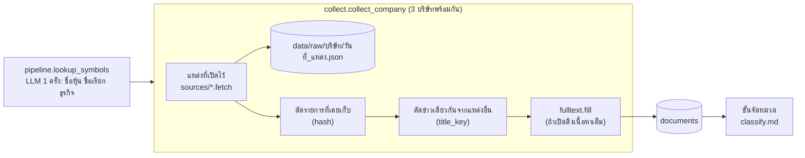

# ระบบดึงข้อมูล

ขั้นแรกของทุกการวิเคราะห์: ดึงข่าว ประกาศ รีวิว และหน้าเว็บของแต่ละบริษัท เก็บไฟล์ดิบ แล้วบันทึกรายการใหม่ลงตาราง `documents`
ภาพรวมทั้งระบบดู [`architecture.md`](../architecture.md) · ข้อจำกัดของแต่ละแหล่งฝั่งผู้ใช้ดู [README](../../README.md#แหล่งข้อมูล)

## ภาพรวม

แต่ละแหล่งเป็นโมดูลแยกใน `core/sources/` ที่มีฟังก์ชัน `fetch(company, limit)` และคืนข้อมูลรูปแบบเดียวกัน
`collect.py` จึงไม่ต้องรู้ว่าแต่ละแหล่งดึงยังไง แค่วนเรียกทีละแหล่ง กันรายการซ้ำ แล้วบันทึก
แหล่งไหนใช้ไม่ได้ (ยังไม่ได้ตั้งค่า เว็บล่ม ถูกบล็อก) จะถูกข้ามพร้อมเหตุผล ไม่ทำให้ทั้งรอบล้ม

ก่อนดึง ระบบหาข้อมูลประกอบของบริษัทที่ยังไม่เคยหา (ชื่อหุ้น ชื่อที่สื่อใช้ ธุรกิจหลัก) ด้วย LLM 1 ครั้งรวมทุกบริษัท
เพราะชื่อที่สื่อใช้ทำให้ค้นข่าวเจอมากขึ้น และธุรกิจหลักช่วยให้ขั้นจัดหมวดตัดข่าวที่ชื่อซ้ำแต่เป็นเรื่องอื่นได้

## ขั้นตอน

1. **ข้อมูลประกอบบริษัท** (`pipeline.lookup_symbols` → `profile.suggest_profiles`)
   - ทำเฉพาะบริษัทที่ `set_symbol` หรือ `business` ยังเป็น NULL (ไม่เคยหา)
   - ถ้าผู้ใช้พิมพ์ชื่อหุ้นจริงมา (เช่น MC) จะส่งชื่อตามทะเบียน SET ไปให้ LLM ด้วย เพื่อไม่ให้เดาผิดบริษัท
   - ชื่อหุ้นที่ LLM ตอบแต่ไม่มีในรายชื่อหุ้นจริง (`set_api.stock_list`) ถูกทิ้ง
   - ชื่อไทยตามทะเบียนถูกใส่เป็นชื่อเรียกอันดับแรก ส่วนชื่อหุ้นที่ผู้ใช้แก้เองไม่ถูกเขียนทับ
2. **เลือกแหล่ง:** ใช้แหล่งที่เลือกในหน้าวิเคราะห์ใหม่ ลบแหล่งที่ปิดไว้เฉพาะบริษัทนั้นออก (`pipeline.enabled_sources`, คอลัมน์ `companies.disabled_sources`)
3. **ดึงพร้อมกัน 3 บริษัท** (`FETCH_WORKERS`) แต่แสดงผลตามลำดับในเธรดหลัก
4. **ในแต่ละบริษัท** (`collect.collect_company`) วนทีละแหล่ง:
   1. `module.fetch(row, limit)` (แหล่งรีวิวใช้ `review_limit`)
   2. เขียนผลทั้งหมดลง `data/raw/{บริษัท}/{วันที่}_{แหล่ง}.json` (ทับไฟล์ของวันเดียวกัน)
   3. ตัดรายการที่ hash มีอยู่แล้วใน `documents`
   4. ตัดข่าวเดียวกันที่มีจากแหล่งอื่นแล้ว: เทียบ `title_key` (ตัดชื่อสำนักข่าวท้าย " - ..." แล้วเหลือแต่ตัวอักษร) กับหัวข้อทั้งหมดของบริษัทนั้น (`db.title_keys`) ไม่ใช้กับรีวิว
   5. ถ้าเปิดดึงเนื้อหาเต็ม ให้เติมเนื้อหาให้รายการใหม่ (ยกเว้นรีวิวและข่าว SET)
   6. `db.insert_document` ทีละรายการ แล้วคืน `stats = {แหล่ง: (ดึงได้, ใหม่)}` และ `notes` (ข้อความบอกผู้ใช้)
5. บริษัทที่ข่าวทุกแหล่ง (ไม่นับรีวิว) ได้ 0 รายการ ถูกรายงานว่า "ไม่พบข่าว"

### แต่ละแหล่ง

| แหล่ง (`collect.SOURCES` key) | `source_type` | วิธีดึง | จุดสำคัญ |
|---|---|---|---|
| `google_news` | `news` | RSS ค้นหาของ Google News ภาษาไทย | ค้นด้วยชื่อหลัก (`limit` ข่าว) + ชื่อเรียกอีกไม่เกิน 2 ชื่อ (`MAX_ALIAS_QUERIES` ชื่อละ `limit/2` อย่างน้อย 5) + "ชื่อ + หัวข้อที่สนใจ" (`topic_queries`) · ชื่อเรียกที่สั้นกว่า 4 ตัวไม่ใช้ค้น · ตัดซ้ำด้วย URL |
| `thai_rss` | `rss` | RSS ของ 6 สำนัก (`FEEDS`) ดึงครั้งเดียวแล้วใช้ซ้ำกับทุกบริษัท 10 นาที (`CACHE_SECONDS`) | จับบริษัทด้วยชื่อ + ชื่อเรียกในหัวข้อหรือเนื้อหา (`_pattern`): ชื่ออังกฤษต้องตรงทั้งคำ ชื่อสั้น (< 6 ตัว) ต้องตรงตัวพิมพ์ ชื่อไทยตรงแบบ substring · ได้เนื้อหามาด้วย |
| `app_reviews` | `review` | App Store: RSS รีวิวของ Apple (ลองซ้ำ 1 ครั้งถ้าได้ feed ว่าง) · Google Play: `google-play-scraper` | ต้องตั้ง `appstore_id` / `play_app_id` ก่อน ไม่งั้น `SourceSkipped` · ปุ่มหาแอปอัตโนมัติใช้ `search_apps` |
| `website` | `website` | `requests` + BeautifulSoup ที่ URL ที่ผู้ใช้ใส่ | เคารพ `robots.txt` · ตัด `nav` / `footer` ทิ้ง · ลิงก์ต้องยาว ≥ 25 ตัว (`MIN_TITLE`) และอยู่โดเมนเดียวกัน · ถ้ามีลิงก์ใต้ path ของหน้า (เช่น `/newsroom/...`) ใช้เฉพาะกลุ่มนั้น |
| `set_news` | `set` | API ภายในของ set.or.th ข่าวแจ้งตลาดย้อนหลัง 90 วัน | ต้องมี `set_symbol` · รายละเอียด API อยู่ใน [`market.md`](market.md) |

เนื้อหาเต็ม (`fulltext.fill`): ทำเฉพาะรายการที่เนื้อหาสั้นกว่า 300 ตัว (`MIN_CHARS`) โดยเปิดพร้อมกัน 4 ลิงก์
ลิงก์ Google News ถูกถอดเป็น URL จริงด้วย `googlenewsdecoder` ก่อน แล้วอ่านบทความด้วย `trafilatura` เก็บไม่เกิน 4,000 ตัว (`MAX_CHARS`)

## LLM

| จุด | ครั้ง | ส่งอะไร | ตรวจคำตอบ |
|---|---|---|---|
| `profile.suggest_profiles` | 1 ครั้งต่อรอบ รวมทุกบริษัทที่ยังไม่เคยหา (รอบต่อไปไม่เรียกซ้ำ) | รายชื่อบริษัท (+ ชื่อตามทะเบียน SET ถ้าพิมพ์ชื่อหุ้นมา) ขอชื่อเรียก 2–5 ชื่อ ชื่อหุ้น และธุรกิจหลัก ตอบ JSON | ชื่อหุ้นต้องมีจริงใน SET · ตัดคำว่า บริษัท/จำกัด/มหาชน · ไม่เกิน 5 ชื่อ · ตัดอักษรจีน · ตอบไม่เป็น JSON = ข้าม (ผู้ใช้กรอกเองได้) |

การดึงข้อมูลส่วนอื่นไม่ใช้ LLM

## ข้อมูลที่อ่าน/เขียน

| ที่ | อ่าน/เขียน | ใช้ทำอะไร |
|---|---|---|
| `companies` | อ่าน + เขียน `set_symbol` `aliases` `business` | การตั้งค่าแหล่งของแต่ละบริษัท และข้อมูลประกอบ |
| `documents` | เขียน | 1 แถวต่อรายการ (`content_hash` UNIQUE กันซ้ำ) |
| `market_cache` key `stocklist` | อ่าน + เขียน | รายชื่อหุ้นทั้งตลาด เก็บ 1 วัน |
| `data/raw/` | เขียน | ไฟล์ดิบของแต่ละแหล่งต่อวัน ไว้ตรวจย้อนหลัง |

hash ของรายการ (`collect._hash`) คือ sha256 ของ `company_id|title|url` สำหรับ Google News (รูปแบบเดิม เก็บไว้เพื่อไม่ให้ข่าวเก่าถูกนับซ้ำ)
และ `company_id|source_type|url|title` สำหรับแหล่งอื่น ข่าวเดียวกันของคนละบริษัทจึงเป็นคนละแถว

## ค่าที่ปรับได้

| ค่า | ที่ | ปัจจุบัน |
|---|---|---|
| จำนวนข่าว / รีวิวต่อแหล่ง | หน้าวิเคราะห์ใหม่ ขั้น ③ (`opts["limit"]`, `opts["review_limit"]`) | 20 / 20 |
| บริษัทที่ดึงพร้อมกัน | `pipeline.FETCH_WORKERS` | 3 |
| ชื่อเรียกที่ใช้ค้น Google News เพิ่ม | `google_news.MAX_ALIAS_QUERIES` | 2 |
| เวลาใช้ RSS ซ้ำ | `thai_rss.CACHE_SECONDS` | 600 วินาที |
| สำนักข่าวไทย | `thai_rss.FEEDS` | 6 สำนัก |
| ความยาวหัวข้อลิงก์ขั้นต่ำ (เว็บบริษัท) | `website.MIN_TITLE` | 25 |
| เนื้อหาเต็ม: สั้นกว่านี้ถึงดึง / เก็บสูงสุด | `fulltext.MIN_CHARS` / `MAX_CHARS` | 300 / 4,000 |
| คำค้นเพิ่มตามหมวดที่สนใจ | `collect.CATEGORY_QUERY` | เช่น promotion → "โปรโมชัน" |

## เมื่อมีปัญหา

- **แหล่งใช้กับบริษัทนี้ไม่ได้** (ยังไม่ตั้งแอป/เว็บ/ชื่อหุ้น, robots.txt ห้าม, ไม่พบลิงก์บทความ): แหล่งนั้น raise `SourceSkipped` พร้อมข้อความ แล้วแหล่งอื่นทำงานต่อ ข้อความแสดงในแถบสถานะ
- **เน็ตหรือเว็บล่ม** (`requests.RequestException`, `ValueError`): ข้ามแหล่งนั้น แจ้งว่า "ดึงไม่สำเร็จ (ชื่อ error)"
- **SET API** ได้ 403 จะขอ cookie ใหม่ 1 ครั้ง ถ้ายังไม่ได้ก็ `SourceSkipped` · ถ้ารายชื่อหุ้นดึงไม่ได้ ใช้ของเก่าใน cache
- **สำนักข่าว RSS บางเว็บล่ม:** ข้ามเว็บนั้น ใช้ที่เหลือ
- **เนื้อหาเต็ม** ดึงไม่ได้ (ถอดลิงก์ไม่ได้ หรือเว็บกัน): ใช้หัวข้ออย่างเดียวเหมือนเดิม และบอกจำนวนที่ได้ เช่น "ได้เนื้อหาเต็ม 16/20"
- **LLM หาข้อมูลบริษัทไม่สำเร็จ:** แจ้งให้ผู้ใช้กรอกชื่อหุ้น/ชื่อเรียกเองในหน้า "บริษัทและแหล่งข้อมูล" แล้ววิเคราะห์ต่อด้วยชื่อหลัก

## สำหรับนักพัฒนา

| ไฟล์ | ฟังก์ชัน | หน้าที่ |
|---|---|---|
| `core/sources/__init__.py` | `item()`, `SourceSkipped`, `UA` | รูปแบบรายการกลาง `{source_type, source_name, title, url, published, content, rating}` |
| `core/collect.py` | `collect_company`, `_hash`, `title_key`, `topic_queries` | วนแหล่ง กันซ้ำ บันทึก |
| `core/fulltext.py` | `fill`, `extract`, `resolve_url` | เนื้อหาเต็ม |
| `core/profile.py` | `suggest_profiles`, `short_name`, `official_names` | ข้อมูลประกอบบริษัท |
| `core/pipeline.py` | `lookup_symbols`, `enabled_sources`, `run` (ขั้น 1/3) | เรียกทั้งหมดนี้ตามลำดับ |
| `ui/company_panel.py` | – | หน้าตั้งค่าแหล่งของแต่ละบริษัท |

**เพิ่มแหล่งใหม่:**
1. สร้าง `core/sources/<ชื่อ>.py` ที่มี `fetch(company, limit)` คืน list ของ `item(...)` ถ้าใช้กับบริษัทนี้ไม่ได้ให้ raise `SourceSkipped("เหตุผล")`
2. เพิ่ม key ใน `collect.SOURCES` (โมดูล + ชื่อที่แสดง)
3. ถ้าใช้ `source_type` ใหม่ ต้องเพิ่มชื่อใน `collect.SOURCE_TYPE_LABEL` (ตัวกรองแหล่ง) · `process.SOURCE_TAG` (บอก LLM ว่าเป็นอะไร) · `ask.SOURCES` (ชื่อในคำตอบ)
4. ถ้าเป็นแหล่งที่ค้นด้วยชื่อ (อาจได้เรื่องอื่นที่ชื่อซ้ำ) เพิ่มใน `process.CHECKED_SOURCES` ด้วย เพื่อให้ LLM ตรวจความเกี่ยวข้อง
5. ถ้าไม่ใช่ข่าว (ไม่ควรนับในตาราง A/B/C) เพิ่มใน `analyze.NOT_NEWS`
6. เพิ่มตัวเลือกใน UI: `ui/company_panel.ALL_SOURCES`

**เทส:** ตอนนี้ยังไม่มีเทสของการดึงข้อมูล เพราะทุกแหล่งต้องใช้เน็ต ที่มีคือ `test_short_name_strips_legal_words` (`tests/test_ask_internal_misc.py`)
