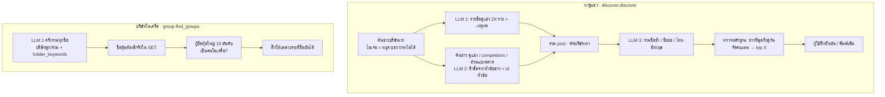

# ระบบหาคู่แข่ง บริษัทในเครือ และรวมบริษัทซ้ำ

ระบบที่ช่วยตั้งรายชื่อบริษัทก่อนวิเคราะห์:
- **หาคู่แข่ง (Phase 3):** ผู้ใช้บอกแค่บริษัทเรา ระบบหาคู่แข่ง top X ให้
- **บริษัทในเครือ:** ใส่ชื่อเครือ เช่น PTT ระบบหาบริษัทลูก/บริษัทร่วมให้ติ๊กเพิ่ม
- **รวมบริษัทซ้ำ:** ชื่อหลายแบบที่เป็นหุ้นตัวเดียวกัน (True / True Corporation / ทรู) ให้รวมเป็นแถวเดียว

## ภาพรวม

รายชื่อบริษัทผิดทำให้ผลวิเคราะห์ทั้งหมดผิด ทั้งสามระบบจึงยึดหลักเดียวกัน:
1. **ไม่เชื่อ LLM อย่างเดียว** ต้องมีหลักฐานจากข่าวหรือทะเบียน SET มายืนยัน
2. **คนยืนยันก่อนเสมอ** ระบบแค่ติ๊กให้เฉพาะรายที่ยืนยันได้ ผู้ใช้ติ๊กออกหรือเพิ่มเองได้
3. **ถ้าหาไม่เจอให้บอกว่าไม่เจอ** แทนการเดารายชื่อ

## หาคู่แข่ง (`discover.discover`)

1. **ค้นข่าวของบริษัทเรา** 20 ข่าว (Google News) ถ้าไม่เจอเลยจะหยุดและบอกว่า "ไม่พบข่าวของ … เลย" (ชื่อที่ไม่มีจริงจึงไม่ได้รายชื่อที่แต่งขึ้น)
2. **จาก LLM** (`_llm_candidates`): ขอคู่แข่งโดยตรงไม่เกิน 2 เท่าของ X พร้อมเหตุผลภาษาไทย 1 ประโยค ถ้าไม่รู้จักบริษัทให้ตอบ `[]`
3. **จากข่าว** (`_news_candidates`):
   - รวมข่าวของเรากับผลค้น "บริษัท คู่แข่ง", "บริษัท competitors" และ "อุตสาหกรรม ส่วนแบ่งตลาด" (ถ้าใส่อุตสาหกรรม) แล้วตัดลิงก์ซ้ำ
   - ให้ LLM ดึงชื่อคู่แข่งโดยตรงพร้อม id ของหัวข้อที่อ้าง โดยห้ามนับพาร์ตเนอร์ ซัพพลายเออร์ ลูกค้า ช่องทีวี หน่วยงานรัฐ บริษัทลูก และสำนักข่าว
   - **ชื่อที่ไม่มีหัวข้อข่าวรองรับถูกทิ้ง** (ถือว่า LLM แต่ง)
4. **รวม pool**:
   - ใช้ `norm` (ตัดคำว่า บริษัท/จำกัด/PCL/Group แล้วเหลือแต่ตัวอักษร) เป็น key
   - ตัดบริษัทเราออก (`_is_self`)
   - ตัดวงเล็บท้ายชื่อเพื่อให้ค้นข่าวเจอ (`clean_name`: "NT (National Telecom)" → "NT")
5. **รวมชื่อซ้ำ** (`_merge`, LLM ครั้งที่ 3): จับกลุ่มชื่อย่อ ชื่อไทย/อังกฤษ และแบรนด์ในเครือเดียวกัน ตัดบริษัทเราและเครือของเรา
   ถ้าตอบไม่ผ่านใช้ผลรวมด้วย `norm` · ชื่อที่ LLM ลืมใส่กลุ่มคงไว้ตามเดิม
6. **ตรวจหลักฐาน** เฉพาะ 2X รายแรก (เรียงตามจำนวนทางที่พบและจำนวนหลักฐาน):
   - ค้นข่าว `"บริษัทเรา" "คู่แข่ง"` ที่พูดถึงคู่กัน (`co_mentions`)
   - ไม่มีข่าวคู่กัน ไม่มีหลักฐานเดิม และค้นชื่อเดี่ยวก็ไม่เจอ = `no_evidence`
7. **คะแนน**:
   - พบทั้งสองทาง 3 · LLM อย่างเดียว 2 (มีเหตุผล) · ข่าวอย่างเดียว 1
   - บวกจำนวนข่าวคู่กัน ÷ 10 (สูงสุด +1)
   - ไม่มีหลักฐาน = −1
   - เลือก top X
8. **หน้ายืนยัน** (`ui/pages/setup.confirm_panel`):
   - checkbox พร้อมเหตุผล ลิงก์ข่าว 3 ข่าว และป้าย "ไม่พบหลักฐาน" (รายที่ไม่มีหลักฐานไม่ถูกติ๊กให้)
   - ผู้ใช้พิมพ์เพิ่มเองได้
   - กดยืนยันแล้วบันทึก `origin='discovered'` (รายที่พิมพ์เองเป็น `user`) แล้ววิเคราะห์แบบ Phase 2 ในหน้าเว็บ (`state.run_pipeline`, mode `discover` → รายงาน `phase3`)

## บริษัทในเครือ (`group.find_groups`)

1. สวิตช์ "รวมบริษัทในเครือ" เปิดไว้ (ค่าเริ่ม) ตอนเริ่มวิเคราะห์ `ui/group_panel.detect` หาเฉพาะชื่อที่ยังไม่เคยหา (ผลเก็บใน `company_groups` ไม่ถาม LLM ซ้ำ)
2. **LLM 1 ครั้งรวมทุกชื่อ:**
   - ขอบริษัทลูก/บริษัทร่วมที่มีแบรนด์หรือธุรกิจของตัวเอง ไม่เกิน 8 รายต่อชื่อ (`per_company`) และไม่เอา holding/shell
   - ถ้าชื่อเป็นเครือ (CP, PTT, SCG) ให้บอกบริษัทหลักของเครือ
   - ขอ `holder_keywords` คือคำที่ใช้จับชื่อผู้ถือหุ้นว่าเป็นคนในเครือ เช่น "ปตท", "PTT"
3. **ตรวจ:**
   - ชื่อหุ้นต้องมีจริงใน SET
   - ตัดรายที่เป็นบริษัทแม่เอง (เช่น SCB → SCB X)
   - ตัดชื่อซ้ำและอักษรจีน
4. **ยืนยันความเป็นเจ้าของ** (`_verify`): ดูผู้ถือหุ้นใหญ่ 10 อันดับแรกของหุ้นนั้น (`set_api.major_shareholders`) ว่ามีชื่อที่ตรง keyword ของเครือไหม
   keyword = `holder_keywords` + ชื่อไทย/อังกฤษตามทะเบียนของหุ้นในเครือ (ไม่นับชื่อของหุ้นตัวเอง เช่น หุ้นซื้อคืน)
   - `True` = ยืนยันได้ (แสดงชื่อผู้ถือหุ้นและ %) · `False` = ผู้ถือหุ้นใหญ่ไม่ใช่คนในเครือ · `None` = ตรวจไม่ได้ (นอกตลาด หรือ SET ใช้ไม่ได้)
5. **หน้าเลือก** (`ui/group_panel.render`):
   - ติ๊กให้เฉพาะ `True`
   - รายที่ซ้ำกับบริษัทที่เลือกไว้แล้ว (ชื่อหรือชื่อหุ้นเดียวกัน) ไม่ถูกเสนอ
   - รวมบริษัทหลัก + ในเครือได้ไม่เกิน 20 บริษัทต่อรอบ (`MAX_COMPANIES`)
6. รายที่ติ๊กถูกสร้างเป็นบริษัท (`register`) พร้อมชื่อหุ้น ชื่อเรียก ธุรกิจ และ `origin='group'`
   ถูกวิเคราะห์แยกเป็นรายบริษัท แต่ **ไม่นับเป็นคู่แข่ง** ในค่าเฉลี่ยคู่แข่งและตาราง gap
   และรายงานได้รับโครงสร้างเครือ (`GROUP_SECTION`) เพื่ออธิบายเป็นส่วนหนึ่งของเครือ

## รวมบริษัทซ้ำ (หน้า "บริษัทและแหล่งข้อมูล" → ดูแลข้อมูล)

- `db.duplicate_groups`: บริษัทที่ชื่อหุ้นเดียวกันแต่เป็นคนละแถว เรียงแถวที่มีข้อมูลมากสุดก่อน
- `db.merge_companies(keep, others)` ย้ายข้อมูลของ `others` มาไว้ที่ `keep`:
  - ข่าว facts งบ และข้อมูลภายในย้ายมา
  - ข่าวที่ซ้ำกับของ `keep` (url หรือหัวข้อเดียวกัน) ถูกลบพร้อม facts และ labels
  - ชื่อเดิมกลายเป็นชื่อเรียกของ `keep` แล้วลบแถว `others`

## LLM

| จุด | ครั้ง | ส่งอะไร | ตรวจคำตอบ |
|---|---|---|---|
| `discover` | 3 ต่อการหา (LLM / ดึงชื่อจากข่าว / รวมชื่อ) · รวมชื่อข้ามได้ถ้ามีไม่ถึง 2 ชื่อ | ตามขั้นที่ 2, 3, 5 | `_named_list`: ต้องเป็น list ของ dict ที่มี `name` · ชื่อจากข่าวต้องมี id หัวข้อที่มีจริง · รวมชื่อไม่ผ่าน = ใช้ผลรวมด้วย `norm` |
| `find_groups` | 1 ต่อรอบ รวมทุกชื่อที่ยังไม่เคยหา | รายชื่อ ขอ JSON บริษัทลูก/ร่วม | ชื่อหุ้นต้องมีจริง · ยืนยันกับผู้ถือหุ้นใหญ่ · ตอบไม่ผ่าน = ไม่มีบริษัทในเครือ แจ้งว่า "หาไม่สำเร็จ" และวิเคราะห์ต่อ |

## ข้อมูลที่อ่าน/เขียน

| ตาราง | อ่าน/เขียน | ใช้ทำอะไร |
|---|---|---|
| `companies` | เขียน | บริษัทที่ยืนยันแล้ว (`origin` = `discovered` / `group` / `user`) |
| `company_groups` | อ่าน + เขียน | ผลการหาบริษัทในเครือต่อชื่อ (ไม่ถามซ้ำ) |
| `market_cache` `stocklist` | อ่าน | ตรวจชื่อหุ้น |
| `documents`, `facts`, `labels`, `financials`, `internal_metrics` | เขียน (ตอนรวมบริษัท) | ย้ายและลบรายการซ้ำ |

## ค่าที่ปรับได้

| ค่า | ที่ | ปัจจุบัน |
|---|---|---|
| จำนวนคู่แข่งที่ต้องการ | หน้าวิเคราะห์ใหม่ (`top_x`) | 5 (เลือก 3–10) |
| ประเทศ / อุตสาหกรรม | หน้าวิเคราะห์ใหม่ | ประเทศไทย / ไม่ระบุ |
| บริษัทในเครือต่อชื่อ | `group.find_groups(per_company=8)` | 8 |
| บริษัทสูงสุดต่อรอบ | `ui/group_panel.MAX_COMPANIES` | 20 |

## เมื่อมีปัญหา

- **ชื่อบริษัทไม่มีจริง / ไม่มีข่าว:** หยุดตั้งแต่ขั้นแรก บอกให้ตรวจตัวสะกด
- **ไม่พบคู่แข่งทั้งสองทาง:** บอกให้ใส่อุตสาหกรรม หรือพิมพ์รายชื่อเอง
- **LLM ตอบผิดรูปแบบ:** ทางนั้นได้ 0 ราย ทางอื่นยังใช้ได้
- **SET ใช้ไม่ได้:** บริษัทในเครือแสดงเป็น "ตรวจไม่ได้" ไม่ถูกติ๊กให้ ผู้ใช้ติ๊กเองได้

## สำหรับนักพัฒนา

| ไฟล์ | ฟังก์ชัน | หน้าที่ |
|---|---|---|
| `core/discover.py` | `discover`, `_llm_candidates`, `_news_candidates`, `_merge`, `norm`, `clean_name`, `_is_self` | หาคู่แข่ง |
| `core/group.py` | `find_groups`, `_keywords`, `_verify` | บริษัทในเครือ |
| `core/db.py` | `save_group`, `get_groups`, `duplicate_groups`, `merge_companies` | ข้อมูล |
| `ui/pages/setup.py` | `confirm_panel` | หน้ายืนยันคู่แข่ง |
| `ui/group_panel.py` | `detect`, `candidates`, `picked`, `register`, `render` | หน้าเลือกบริษัทในเครือ |
| `ui/maintenance_panel.py` | – | รวมบริษัทซ้ำ |

- **เทส:** ยังไม่มีเทสของ `discover` และ `group` เพราะต้องใช้ LLM และเน็ต
  ที่ควรทดสอบด้วยมือตาม [`mockup-steps.md`](../mockup-steps.md) Phase 3: บริษัทที่รู้คำตอบ 2–3 ราย และชื่อที่ไม่มีจริง
