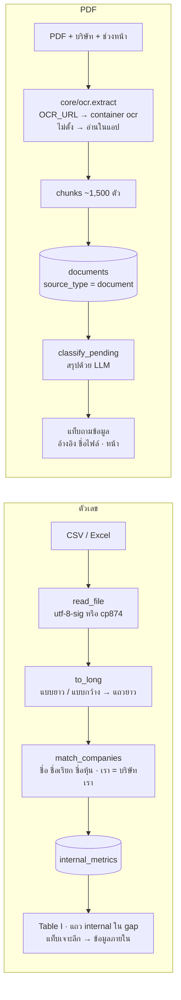

# ระบบข้อมูลภายใน (CSV / Excel) และเอกสาร PDF (OCR)

หน้า "ข้อมูลภายใน" รับข้อมูลที่มีแค่ในบริษัท 2 แบบ:
- **ตัวเลข** (CSV/Excel) เช่น ยอดขาย ลูกค้าใหม่ NPS ส่วนแบ่งตลาด เพื่อเทียบกับคู่แข่งในตาราง "เรา vs คู่แข่ง" และในรายงาน
- **เอกสาร PDF** เช่น รายงานภายใน โบรชัวร์หรือใบราคาของคู่แข่ง เพื่อให้แท็บถามข้อมูลค้นและอ้างอิงได้ (หน้าสแกนใช้ OCR)

## ภาพรวม

ข้อมูลสาธารณะ (ข่าว งบ รีวิว) บอกได้ไม่หมด ตัวเลขภายในอย่างส่วนแบ่งตลาดหรือ NPS ทำให้การเทียบตรงขึ้น
ระบบจึงให้อัปโหลดได้ โดยรับรูปแบบไฟล์หลากหลาย จับชื่อบริษัทกับรายชื่อในระบบให้ และบอกชัดว่าอะไรจะถูกส่งให้ LLM

ดูแบบโต้ตอบ (archify): [pdf-ocr.html](../diagrams/pdf-ocr.html)

## ตัวเลข (CSV / Excel)

1. **อ่านไฟล์** (`internal.read_file`): `.xlsx`/`.xls` ด้วย pandas (openpyxl) · CSV ลอง `utf-8-sig` ก่อนแล้ว `cp874` (CSV ภาษาไทยจาก Excel รุ่นเก่า)
2. **แปลงเป็นแถวยาว** (`to_long`) รับ 2 แบบ:
   - **แบบยาว:** มีคอลัมน์ บริษัท, ตัวชี้วัด, ค่า (+ หน่วย, ช่วงเวลา ไม่บังคับ) · ชื่อคอลัมน์ที่รับ (`COLUMNS`) มีทั้งไทยและอังกฤษ เช่น "ตัวชี้วัด" / "kpi" / "metric"
   - **แบบกว้าง:** คอลัมน์แรกเป็นบริษัท คอลัมน์อื่นเป็นตัวชี้วัด
   - แปลงค่า "1,234.5", "45%", "฿1,000" เป็นตัวเลข (`_number`) ค่าที่ไม่ใช่ตัวเลขถูกข้ามและบอกเป็นรายแถว
3. **จับชื่อบริษัท** (`match_companies`) กับชื่อ ชื่อหุ้น และชื่อเรียกในระบบ (ไม่สนตัวพิมพ์)
   "เรา", "บริษัทเรา", "us" (`SELF_WORDS`) = บริษัทเราของการวิเคราะห์ที่กำลังตั้ง · ชื่อที่จับไม่ได้ยังบันทึกได้ แต่จะใช้เมื่อวิเคราะห์ชื่อนั้นเท่านั้น
4. **บันทึก** (`db.save_internal`): key คือ (บริษัท, ตัวชี้วัด) อัปโหลดซ้ำ = แทนค่าเดิม · มีไฟล์ตัวอย่างให้โหลด (`TEMPLATE`)
5. **ใช้ที่ไหน:**
   - `analyze.internal_table` → Table I + Table U (หน่วย/ช่วงเวลา) ในรายงาน โดย prompt บอกให้เรียกว่า "ข้อมูลภายใน"
   - แถว `internal` ในตาราง gap: ของเรา − ค่าเฉลี่ยคู่แข่งที่มีค่านั้น (ต้องมีค่าของเราและคู่แข่งอย่างน้อย 1 ราย)
   - แท็บเจาะลึก → "ข้อมูลภายใน"
6. **สวิตช์ "ให้ LLM ใช้ข้อมูลภายในตอนเขียนรายงาน"** (ค่าเริ่มเปิด) ปิดแล้วตัวเลขไม่ถูกส่งออกนอกเครื่อง (`opts["internal"]`)

## เอกสาร PDF

1. **เลือกไฟล์และบริษัท** (`ui/internal_panel._pdf_upload`):
   - ต้องมีบริษัทในระบบก่อน (ค่าเริ่มเป็นบริษัทเรา)
   - ไฟล์เกิน 30 หน้าให้เลือกช่วงหน้า (`ocr.MAX_PAGES`) แล้วอัปโหลดซ้ำเพื่ออ่านช่วงถัดไป
2. **อ่านทีละหน้า** (`ocr/extract.extract_pages`):
   - ใช้ข้อความที่ฝังในไฟล์ก่อน (`page.get_text()`)
   - ถ้า `needs_ocr` จริง ให้ render 300 dpi แล้วส่ง Tesseract `tha+eng` (timeout 60 วินาทีต่อหน้า) แล้วตัดช่องว่างที่ Tesseract แทรกระหว่างอักษรไทย
   - `needs_ocr` เป็นจริงเมื่อ: ข้อความสั้นกว่า 40 ตัว **หรือ** มีอักษร Private Use Area / `�` เกิน 1% (อาการของ PDF ไทยที่ฟอนต์ map ผิด) **หรือ** ตัวอักษรไทย/อังกฤษ/ตัวเลข/วรรคตอนน้อยกว่า 70%
   - แต่ละหน้าได้ `method` = `text` / `ocr` / `skipped` (ต้อง OCR แต่ปิดไว้หรือล้มเหลว)
3. **OCR ที่ไหน** (`core/ocr.extract`):
   - ตั้ง `OCR_URL` = POST ไป container `ocr` (`ocr/app.py`, FastAPI `POST /extract` รับ `file`, `first`, `last`)
   - ไม่ตั้ง = อ่านในแอปเอง และ OCR ได้ถ้าเครื่องมี Tesseract ไม่งั้นหน้าสแกนเป็น `skipped`
4. **ตัดเป็นส่วน** (`ocr.chunks`): รวมหน้าสั้นต่อกัน ตัดหน้ายาว ส่วนละไม่เกิน 1,500 ตัว (`CHUNK_CHARS`) แต่ละส่วนจำช่วงหน้า
5. **บันทึก** (`internal.save_pdf`):
   - เก็บไฟล์ต้นฉบับที่ `data/uploads/<sha256>.pdf`
   - แต่ละส่วนเป็น 1 แถวใน `documents`: `source_type='document'`, `title` = "ชื่อไฟล์ · หน้า a–b", `url` = `upload://<sha12>#page=a`
   - `content_hash` = `sha256:ช่วงหน้า:ลำดับ` ไฟล์เดิมช่วงเดิมจึงไม่ถูกบันทึกซ้ำ
6. **สรุปด้วย LLM** ทันที (`process.classify_pending` ของบริษัทนั้น ถือว่าเกี่ยวเสมอ) แล้วโหลดผลที่เปิดอยู่ใหม่ (`_refresh_result`) ให้แท็บถามเห็นทันที
7. **ใช้ที่ไหน:** แท็บถามข้อมูลเท่านั้น ([`ask.md`](ask.md)) ที่มาแสดงเป็น "ชื่อไฟล์ · หน้า x" ไม่มีลิงก์
   ไม่นับในตาราง A/B/C, gap, กราฟ และการแจ้งเตือน (`analyze.NOT_NEWS`) เพราะมีแค่บางบริษัท ตัวเลขเปรียบเทียบจะเพี้ยน
8. **ลบ** รายไฟล์ต่อบริษัท (`db.delete_uploaded`) ลบ labels → facts → documents ของไฟล์นั้น

## LLM

| จุด | ครั้ง | ส่งอะไร |
|---|---|---|
| ตัวเลขภายใน | 0 ตอนอัปโหลด · ไปกับรายงานเมื่อเปิดสวิตช์ | Table I + U ใน prompt รายงาน |
| PDF | ⌈จำนวนส่วน ÷ 5⌉ ตอนอัปโหลด (ชุดที่มีเนื้อหา) | เนื้อหาส่วนละไม่เกิน 600 ตัวแรกให้จัดหมวดและสรุป ([`classify.md`](classify.md)) · เนื้อหาเต็มของส่วนใช้ค้นด้วยคำค้นในแท็บถาม |

OCR ไม่ใช้ LLM

## ข้อมูลที่อ่าน/เขียน

| ที่ | อ่าน/เขียน | ใช้ทำอะไร |
|---|---|---|
| `internal_metrics` | อ่าน + เขียน | ตัวเลขภายใน (บริษัท, ตัวชี้วัด) เป็น key |
| `documents`, `facts` | เขียน | ส่วนของ PDF และผลสรุป |
| `data/uploads/` | เขียน | PDF ต้นฉบับ (บน cloud ย้ายไป OBS) |

## ค่าที่ปรับได้

| ค่า | ที่ | ปัจจุบัน |
|---|---|---|
| ชื่อคอลัมน์ที่รับ | `internal.COLUMNS` | ไทย + อังกฤษ |
| คำที่แปลว่าบริษัทเรา | `internal.SELF_WORDS` | เรา บริษัทเรา us self ours |
| ขนาดไฟล์ / หน้าต่อครั้ง | `ocr/extract.MAX_MB` / `MAX_PAGES` | 20 MB / 30 หน้า |
| เกณฑ์หน้าที่ต้อง OCR | `ocr/extract.MIN_CHARS` และสัดส่วนใน `needs_ocr` | 40 ตัว · PUA > 1% · ตัวอักษรปกติ < 70% |
| ความละเอียด / timeout OCR | `ocr/extract.DPI` / `OCR_TIMEOUT` | 300 dpi / 60 วินาทีต่อหน้า |
| ขนาดส่วน | `core/ocr.CHUNK_CHARS` | 1,500 ตัว |
| ที่อยู่ service OCR | env `OCR_URL` | ไม่ตั้ง = อ่านในแอป |

## เมื่อมีปัญหา

- **CSV อ่านไม่ได้:** แจ้งให้บันทึกเป็น CSV UTF-8 หรือ .xlsx
- **ไม่พบตัวเลข:** แจ้งให้ตรวจคอลัมน์หรือดูไฟล์ตัวอย่าง
- **PDF เสีย / มีรหัสผ่าน / ใหญ่เกิน / เกิน 30 หน้า:** แจ้งเป็นข้อความไทย (`ValueError` จาก `extract.py` หรือ HTTP 400 จาก service)
- **ติดต่อ service OCR ไม่ได้:** "ติดต่อ service OCR ไม่ได้ (url)" ให้เปิด container (`docker start ocr`)
- **หน้าสแกนแต่ไม่มี OCR:** บันทึกเฉพาะหน้าที่มีข้อความ ถ้าไม่มีเลยแจ้งว่า "ไม่พบข้อความที่อ่านได้"
- **OCR หน้าหนึ่งล้มเหลว** (timeout): หน้านั้นเป็น `skipped` หน้าอื่นทำต่อ
- **ข้อจำกัดที่รู้:** Tesseract ไทยพลาดวรรณยุกต์บางตัว (เช่น "เพิ่มขึ้น" → "เพิมขืน") และอ่านตารางหลายคอลัมน์ในหน้าสแกนเรียงไม่ดี

## สำหรับนักพัฒนา

| ไฟล์ | ฟังก์ชัน | หน้าที่ |
|---|---|---|
| `core/internal.py` | `read_file`, `to_long`, `match_companies`, `save_pdf`, `TEMPLATE` | อ่านและบันทึก |
| `core/analyze.py` | `internal_table`, `gap_table` (แถว internal) | ใช้ในรายงาน |
| `ocr/extract.py` | `needs_ocr`, `page_count`, `extract_pages` | อ่าน PDF (ใช้ทั้งใน container และในแอป) |
| `ocr/app.py`, `ocr/Dockerfile` | `POST /extract`, `GET /health` | service OCR |
| `core/ocr.py` | `extract`, `chunks` | ตัวเรียกฝั่งแอป |
| `core/db.py` | `save_internal`, `internal_metrics`, `clear_internal`, `uploaded_documents`, `delete_uploaded` | ข้อมูล |
| `ui/internal_panel.py` | `_upload`, `_pdf_section`, `_pdf_upload`, `_refresh_result` | หน้าข้อมูลภายใน |

- **รันและทดสอบ OCR:** ดู [README](../../README.md) หัวข้อ "อ่าน PDF สแกน (OCR)"
- **ต่อยอด** (ยังไม่ทำ): PDF แนบของประกาศ SET และข่าวที่ลิงก์เป็น PDF ให้เรียก `core/ocr.extract` จาก `collect` / `fulltext` แบบเดียวกัน
- **เทส:**
  - `test_internal_long_and_wide_formats` (`tests/test_ask_internal_misc.py`)
  - `tests/test_ocr.py` ทั้งไฟล์: อ่านข้อความ/ข้ามหน้าสแกน ช่วงหน้า `needs_ocr` `chunks` บันทึกซ้ำไม่เพิ่มแถว ไม่นับเป็นข่าว อ้างอิงเป็นข้อความ และ OCR จริงเมื่อมี Tesseract
