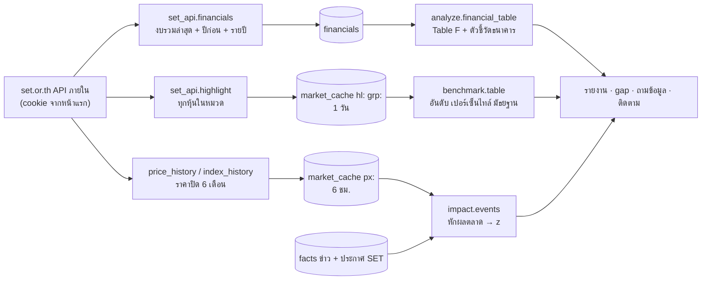

# ระบบข้อมูลตลาดหุ้น (งบ · เทียบทั้งหมวด · ราคาหุ้นหลังข่าว)

ข้อมูลจากเว็บตลาดหลักทรัพย์ฯ (set.or.th) สำหรับบริษัทจดทะเบียน 3 ส่วน:
- **งบการเงิน** ของแต่ละบริษัท (Table F)
- **เทียบทั้งหมวด** คืออันดับเมื่อเทียบกับทุกบริษัทในหมวดธุรกิจเดียวกัน (Table S)
- **ราคาหุ้นหลังข่าว** คือวันที่มีข่าวแล้วหุ้นขยับผิดปกติ (Table P)

ทั้งหมดดึงตอนวิเคราะห์เมื่อเปิดแหล่ง "งบการเงิน (SET)" หรือกดปุ่มดึงในแท็บเจาะลึก และคิดด้วย pandas ไม่ผ่าน LLM

## ภาพรวม

SET ไม่มี API สาธารณะแบบฟรี ระบบจึงเรียก API ภายในที่หน้าเว็บ set.or.th ใช้ (`core/sources/set_api.py`)
ซึ่งอาจเปลี่ยนหรือถูกบล็อกได้ ทุกจุดจึง raise `SourceSkipped` แทนการทำให้แอปพัง และเก็บผลไว้ใน `market_cache` เพื่อเรียกให้น้อยที่สุด
ถ้าจะใช้งานจริงควรเปลี่ยนไปใช้ SETSMART (บริการแบบเสียเงินของ SET)

ดูแบบโต้ตอบ (archify): [market.html](../diagrams/market.html)

## ขั้นตอน

### การเรียก SET API (`set_api._get`)

- เปิดหน้าแรก `/th/home` ก่อนเพื่อรับ cookie (ไม่งั้นได้ 403) ใช้ session เดิมตลอด process
- ได้ 403 จะขอ cookie ใหม่ 1 ครั้ง · 404 = "ไม่พบชื่อหุ้นนี้" · error อื่น = `SourceSkipped("SET API ใช้ไม่ได้ตอนนี้ ...")`
- **รายชื่อหุ้นทั้งตลาด** (`stock_list`) โหลดครั้งเดียวต่อ process เก็บใน `market_cache` 1 วัน ถ้า SET ใช้ไม่ได้จะใช้ของเก่า
  - ใช้ในช่องเลือกบริษัท (`listed_companies` = หุ้นสามัญ SET + mai ราว 930 ตัว)
  - ใช้ตรวจชื่อหุ้นที่ LLM เสนอ ([`collect.md`](collect.md))

### งบการเงิน (`pipeline.fetch_financials` → `set_api.financials`)

1. ข้ามบริษัทที่ไม่มีชื่อหุ้น หรือปิดงบไว้เฉพาะบริษัทนั้น
2. งบรวม (`fsType == "C"`) รายไตรมาส/สะสมของปีนี้และปีก่อน แล้วเลือกงวดล่าสุด เทียบกับงวดเดียวกันของปีก่อน
3. อ่านบัญชีจากชื่อบรรทัด (`ACCOUNTS`) เพราะรหัสบัญชีต่างกันตามแบบงบ: รวมรายได้ EBITDA กำไรสุทธิส่วนบริษัทใหญ่ EPS
   หน่วยในงบเป็นพันบาท แปลงเป็นล้านบาท
4. **ธนาคาร** (แบบงบ `ธุรกิจธนาคาร`):
   - รายได้ = ผลรวมของรายได้ดอกเบี้ยสุทธิ ค่าธรรมเนียม เงินปันผล และกำไรจากเงินลงทุน/เครื่องมือทางการเงิน (`BANK_INCOME`)
   - อ่านงบฐานะการเงินเพิ่ม: สินเชื่อ เงินฝาก สินทรัพย์รวม
5. งบรายปีย้อนหลัง (ROE D/E อัตรากำไร) + ข้อมูลตลาด (มูลค่าตลาด P/E ปันผล) แล้วบันทึกลงตาราง `financials`
6. `analyze.financial_table` คิด Table F:
   - % เติบโต YoY ไม่คิดเมื่อฐานติดลบหรือเป็นศูนย์
   - อัตรากำไรสุทธิ / EBITDA
   - ROE และ D/E จากงบทั้งปีล่าสุด
   - ธนาคาร (`bank_metrics`): NII, NIM ประมาณ (NII ต่อปี ÷ สินทรัพย์รวม), cost to income, credit cost (ต่อปี ÷ สินเชื่อ), LDR · งบสะสม n เดือนถูกแปลงเป็นต่อปีก่อนหาร

### เทียบทั้งหมวด (`benchmark`)

1. `refresh`:
   - หาหมวดของแต่ละหุ้น (`set_api.peers`: ใช้ sector ถ้ามี ส่วนหุ้น mai ที่ไม่มี sector ใช้กลุ่มอุตสาหกรรมใน mai แทน)
   - ดึง `highlight` ของทุกหุ้นในหมวดที่ยังไม่มีหรือเก่ากว่า 24 ชม. (หุ้นละ 2 call ดึงพร้อมกัน 4 หุ้น)
   - `highlight` ใช้เฉพาะงบทั้งปี (`Q9`) เพราะงบสะสม 6M/9M เทียบกับทั้งปีไม่ได้
2. `table`: ต่อบริษัทต่อตัวชี้วัด คืน ค่า อันดับ (`rank` 1 = ดีที่สุด) จำนวนบริษัทที่มีค่านั้น (`n`) เปอร์เซ็นไทล์ และมัธยฐาน
   ต้องมีอย่างน้อย 3 บริษัทในหมวด (`MIN_PEERS`)
3. ทิศทางของตัวชี้วัด (`METRICS`): สูง = ดี (รายได้โต กำไรโต อัตรากำไร ROE มูลค่าตลาด ปันผล) · D/E ต่ำ = ดี · P/E ไม่ตัดสินดี/แย่ (ในอันดับนับต่ำเป็นอันดับ 1)
4. `highlights`: 1 บรรทัดต่อบริษัท บอกตัวชี้วัดที่อันดับดีสุด และจุดอ่อนถ้าต่ำกว่าครึ่งหมวด (ไม่นับมูลค่าตลาดและ P/E)
5. `suggest`: บริษัทที่ใหญ่สุดตามมูลค่าตลาดในหมวดเดียวกันที่ยังไม่ได้เลือก ใช้กับปุ่ม "เพิ่มบริษัทในหมวดเดียวกับ …" ในหน้าวิเคราะห์ใหม่

### ราคาหุ้นหลังข่าว (`impact`)

1. `refresh`: ราคาปิดรายวัน 6 เดือน (`PERIOD`) ของหุ้น และดัชนีที่ใช้เทียบ (SET หรือ mai ตามตลาดของหุ้น) เก็บ 6 ชม.
2. `events` ต่อบริษัท:
   - ใช้ข่าวจากแหล่ง news, rss, set (`SOURCES`)
   - ข่าวหลัง 16:30 (`CLOSE`) นับเป็นวันทำการถัดไป
   - รวมข่าววันเดียวกันเป็น 1 เหตุการณ์
3. ผลตอบแทน 1 และ 3 วันทำการเทียบราคาปิดก่อนข่าว (`r1`, `r3`) ลบผลตอบแทนของดัชนีช่วงเดียวกัน = abnormal return (`ar1`, `ar3`)
4. `z` = abnormal return ÷ ความผันผวนรายวันปกติของส่วนต่างนั้น (3 วันใช้ ÷ √3) แล้วเลือกค่าที่มากกว่าระหว่าง 1 กับ 3 วัน · |z| ≥ 2 (`Z_LIMIT`) = ผิดปกติ (`big`)
5. แนบหัวข้อข่าวที่น่าจะเป็นต้นเหตุไม่เกิน 3 ข่าว (`_pick`: ประกาศ SET ก่อน แล้วข่าวลบ แล้วข่าวอื่น)
6. `big_moves`: วันที่ผิดปกติใน 30 วันล่าสุด ใช้ใน snapshot ของการติดตาม ([`monitor.md`](monitor.md))
7. `describe`: ข้อความเช่น "−7.6% ใน 3 วัน (ตลาด −0.8% · หักตลาดแล้ว −6.7%, 4.4 เท่าของปกติ)"

ใช้ที่ไหน:
- รายงาน (Table P ไม่เกิน 8 แถว)
- ถามข้อมูล
- สิ่งที่ควรรู้
- แท็บเจาะลึก → "ราคาหุ้นหลังข่าว" (กราฟราคา 6 เดือนพร้อมจุดข่าว, `ui/sections/market.py`) · ส่วน "งบการเงิน" และ "เทียบทั้งหมวด" อยู่ในแท็บเดียวกัน
- แจ้งเตือนเมื่อมีวันผิดปกติใหม่

## LLM

ไม่ใช้ LLM ทั้งระบบ ตัวเลขทุกตัวคิดด้วย pandas แล้วส่งให้ LLM ใช้อ้างอิงในรายงานและคำตอบเท่านั้น
prompt บอก LLM ว่าห้ามเทียบตัวเงินเมื่องวดต่างกัน ห้ามเทียบอัตรากำไรข้ามหมวด และ rank 1 = ดีที่สุด (`analyze.FINANCE_SECTION`, `SECTOR_SECTION`, `PRICE_SECTION`)

## ข้อมูลที่อ่าน/เขียน

| ที่ | key | อายุ |
|---|---|---|
| `financials` | 1 แถวต่อบริษัท (`company_id`) ผลของ `set_api.financials` | ดึงใหม่ทุกครั้งที่วิเคราะห์โดยเปิดแหล่งงบ |
| `market_cache` | `stocklist` รายชื่อหุ้น | 24 ชม. |
| `market_cache` | `grp:<หุ้น>` หมวดและรายชื่อหุ้นในหมวด · `hl:<หุ้น>` ตัวเลขสรุป | 24 ชม. |
| `market_cache` | `px:<หุ้น>`, `px:^SET`, `px:^mai` ราคาปิดรายวัน | 6 ชม. |

`frames` / `table` / `prices` อ่านจาก DB อย่างเดียว (ใช้ตอนแสดงผล) ส่วน `refresh` เป็นตัวเดียวที่เรียก SET

## ค่าที่ปรับได้

| ค่า | ที่ | ปัจจุบัน |
|---|---|---|
| อายุ cache หมวด / ราคา | `benchmark.MAX_AGE_HOURS` / `impact.MAX_AGE_HOURS` | 24 / 6 ชม. |
| บริษัทขั้นต่ำในหมวด | `benchmark.MIN_PEERS` | 3 |
| ตัวชี้วัดและทิศทาง | `benchmark.METRICS` | 8 ตัว |
| ช่วงราคา / วันขั้นต่ำ | `impact.PERIOD` / `MIN_DAYS` | 6M / 20 วัน |
| เกณฑ์ผิดปกติ | `impact.Z_LIMIT` | 2.0 |
| เวลาปิดตลาด | `impact.CLOSE` | 16:30 |
| ชื่อบัญชีที่อ่านจากงบ | `set_api.ACCOUNTS`, `BANK_INCOME`, `BALANCE` | – |

## เมื่อมีปัญหา

- **SET API ใช้ไม่ได้:** ทุกขั้น `SourceSkipped` แอปวิเคราะห์ต่อโดยไม่มีตัวเลขตลาด และแจ้งเหตุผลในแถบสถานะ · รายชื่อหุ้นใช้ของเก่าใน cache
- **บริษัทนอกตลาด** (เช่น NT): ไม่มีงบ ไม่มีอันดับ ไม่มีราคา · prompt บอก LLM ห้ามเดาตัวเลข
- **หมวดมีบริษัทน้อยกว่า 3:** ไม่จัดอันดับ
- **ราคาน้อยกว่า 20 วัน หรือไม่มีดัชนี:** ไม่คิดเหตุการณ์ หรือคิดโดยไม่หักตลาด (`adjusted = False`)
- **ข้อจำกัดที่รู้:** ไม่มี NPL ของธนาคาร (งบย่อของ SET ไม่มี) · ยังไม่หักวันขึ้นเครื่องหมาย XD

## สำหรับนักพัฒนา

| ไฟล์ | ฟังก์ชัน | หน้าที่ |
|---|---|---|
| `core/sources/set_api.py` | `_get`, `stock_list`, `listed_companies`, `peers`, `highlight`, `financials`, `price_history`, `index_history`, `market_of`, `major_shareholders` | API |
| `core/analyze.py` | `financial_table`, `bank_metrics` | Table F |
| `core/benchmark.py` | `refresh`, `frames`, `table`, `percentiles`, `suggest`, `highlights`, `symbols_of` | เทียบทั้งหมวด |
| `core/impact.py` | `refresh`, `prices`, `events`, `big_moves`, `describe` | ราคาหลังข่าว |
| `core/pipeline.py` | `fetch_financials`, `fetch_sector` | เรียกตอนวิเคราะห์ |
| `ui/sections/finance.py`, `ui/sections/market.py` | – | แท็บเจาะลึก |

- **เพิ่มบัญชีจากงบ:** เพิ่มชื่อบรรทัด (ตัดช่องว่างแล้ว) ใน `set_api.ACCOUNTS` → คิดใน `analyze.financial_table` → ถ้าจะให้รายงานใช้ อธิบายคอลัมน์ใน `FINANCE_SECTION`
- **เปลี่ยนไปใช้ SETSMART:** แทน `set_api` โดยคงรูปแบบที่คืนเดิม (`financials`, `highlight`, `price_history`) ส่วนอื่นไม่ต้องแก้
- **เทส:**
  - `tests/test_benchmark.py`: `test_rank_and_median`, `test_percentiles_right_is_better`, `test_highlights_names_best_and_weak`
  - `tests/test_impact.py`: `test_stock_jump_flat_market_is_abnormal`, `test_market_moved_too_is_not_abnormal`, `test_news_after_close_counts_next_day`, `test_describe_mentions_market`
