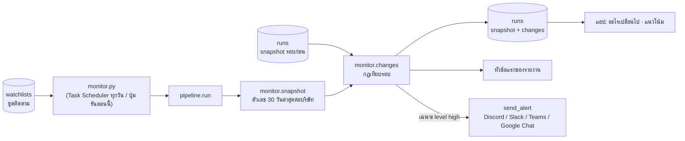

# ระบบติดตามอัตโนมัติและแจ้งเตือน

บันทึกชุดบริษัทที่วิเคราะห์ไว้เป็น "ชุดติดตาม" แล้วให้ระบบวิเคราะห์ซ้ำทุกวัน เทียบตัวเลขกับรอบก่อนว่าอะไรเปลี่ยน
แล้วแสดงในแอป ("อะไรเปลี่ยนไปตั้งแต่รอบก่อน" และหัวข้อแรกของรายงาน) และส่งเข้าแชตเมื่อมีเรื่องสำคัญ

## ภาพรวม

ทุกรอบวิเคราะห์ ทั้งรอบที่กดในแอปและรอบอัตโนมัติ จะเก็บ **snapshot** คือตัวเลขสรุปต่อบริษัท ณ รอบนั้น ไว้ในตาราง `runs`
รอบถัดไปนำ snapshot ใหม่มาเทียบกับรอบล่าสุดที่มีบริษัทนั้น และดูรายการที่ดึงมาหลังเวลาของรอบก่อน
กฎการเตือนทั้งหมดคิดด้วย pandas **ไม่ใช้ LLM** จึงไม่เสียค่า LLM เพิ่ม และไม่แต่งเรื่องขึ้นมาเอง

ดูแบบโต้ตอบ (archify): [monitor.html](../diagrams/monitor.html)

## ขั้นตอน

1. **บันทึกชุด** (หน้า "ติดตามอัตโนมัติ" หรือปุ่ม "ติดตาม" บนหน้าผล, `watch_panel.save_form`):
   เก็บ config ของผลที่เปิดอยู่ (บริษัท บริษัทเรา โหมด หัวข้อที่สนใจ บริษัทในเครือ แหล่งข้อมูล) ลง `watchlists`
2. **ตั้งเวลา** (`watch_panel._schedule`): สร้างงาน `CompetitorCompareMonitor` ใน Windows Task Scheduler ด้วย `schtasks /SC DAILY` ให้รัน `pythonw monitor.py` ตามเวลาที่เลือก (ค่าเริ่ม 08:00)
   เครื่องที่ไม่ใช่ Windows จะแสดงบรรทัด crontab ให้ copy แทน
3. **รัน** (`monitor.py`): วนทุกชุด → `pipeline.run(..., watch_id=id)` ชุดหนึ่งพังไม่ทำให้ชุดอื่นหยุด · ปุ่ม "รันตอนนี้" เรียก `monitor.py --id <ชุด>` เบื้องหลัง
4. **snapshot** (`monitor.snapshot`) ต่อบริษัท จากรายการที่เผยแพร่ใน 30 วันล่าสุด (`WINDOW_DAYS`):
   - `news_30d` และ % ข่าวลบ/บวก (ข่าว = `analyze.news_only` ไม่นับรีวิวและ PDF ที่อัปโหลด)
   - `reviews_30d` และ `stars_30d`
   - งวดงบล่าสุด (`fin_period`) และการเติบโต
   - `price_moves` วันที่หุ้นขยับผิดปกติหลังข่าว (เมื่อเปิดแหล่งงบการเงิน)
5. **เทียบรอบก่อน** (`monitor.changes`): ใช้ snapshot ล่าสุดที่มีบริษัทนั้น (`db.previous_snapshots`) และรายการที่ `fetched_at` ใหม่กว่าเวลาของรอบนั้น
6. **บันทึก** `runs` (snapshot + changes + report_id) แล้ว `monitor.py` สร้างข้อความ (`alert_text`) และส่ง (`send_alert`) ถ้ามีเรื่อง level `high` และตั้ง webhook ไว้
7. **ในแอป:**
   - กล่อง "อะไรเปลี่ยนไปตั้งแต่รอบก่อน"
   - การ์ดชุดติดตามบอกจำนวนเรื่องสำคัญของรอบล่าสุด
   - แท็บเจาะลึก → "แนวโน้ม" (`ui/sections/news.section_trends`) แสดงจำนวนข่าว % ข่าวลบ และดาวรีวิวรายสัปดาห์ (แสดงเมื่อข้อมูลมีอย่างน้อย 2 สัปดาห์)

### กฎการเตือน

| เรื่อง (`kind`) | เงื่อนไข | level |
|---|---|---|
| `set` | มีข่าวแจ้งตลาด SET ใหม่ | high |
| `negative` | มีข่าวลบใหม่ (ไม่นับข่าว SET) | high |
| `promotion` | มีข่าวหมวดสินค้า/ราคา หรือโปรโมชันใหม่ ที่ไม่ใช่ข่าวลบ | info |
| `volume` | จำนวนข่าวและรีวิวใหม่ตั้งแต่รอบก่อน (มีรายการใหม่เมื่อไรก็แสดง) | info |
| `price_move` | มีวันที่หุ้นขยับผิดปกติหลังข่าวที่รอบก่อนยังไม่มี (รอบก่อนต้องเก็บข้อมูลนี้แล้ว ไม่งั้นไม่เตือนย้อนหลัง) | high |
| `financials` | งวดงบเปลี่ยน (งบใหม่ออก) พร้อม % กำไรสุทธิ YoY | high |
| `sentiment` | % ข่าวลบ 30 วันเปลี่ยน ≥ 10 จุด (`NEG_JUMP_PTS`) ทั้งสองรอบต้องมีข่าว ≥ 5 (`MIN_NEWS`) | high ถ้าเพิ่ม · info ถ้าลด |
| `reviews` | ดาวรีวิว 30 วันเปลี่ยน ≥ 0.3 (`STAR_JUMP`) ทั้งสองรอบต้องมีรีวิว ≥ 5 | high ถ้าลด · info ถ้าเพิ่ม |

- บริษัทที่ยังไม่มีรอบก่อนไม่ถูกเตือน เพราะข้อมูลทุกอย่างใหม่หมด
- แต่ละเรื่องแนบตัวอย่างไม่เกิน 5 รายการ (`MAX_ITEMS`) และเรียง high ก่อน แล้วตามลำดับบริษัท

### แจ้งเตือน

- ตั้ง `ALERT_WEBHOOK_URL` ใน `.env`
- URL ที่มีคำว่า `discord` ส่ง `{"content": ...}` (ตัดที่ 1,900 ตัว) · ที่อื่นส่ง `{"text": ...}` (Slack, Teams, Google Chat)
- ข้อความ: หัว `📊 ชื่อชุด · เวลา` + บรรทัดละเรื่อง + ตัวอย่าง 3 รายการพร้อมลิงก์
- ทดสอบด้วยปุ่ม "ทดสอบส่ง" หรือ `python monitor.py --test-alert`

## LLM

ส่วนเทียบรอบและแจ้งเตือนไม่ใช้ LLM · LLM ที่ใช้ในรอบอัตโนมัติคือของ `pipeline.run` ปกติ (จัดหมวดรายการใหม่ + รายงาน 1 ครั้งต่อชุด)
ประมาณ 1 ครั้งต่อข่าวใหม่ 10 ข่าว + 1 ครั้งต่อชุด (ตามข้อความในหน้าตั้งเวลา)

## ข้อมูลที่อ่าน/เขียน

| ที่ | อ่าน/เขียน | ใช้ทำอะไร |
|---|---|---|
| `watchlists` | อ่าน + เขียน | ชุดติดตาม (`config_json`) |
| `runs` | อ่าน + เขียน | snapshot, changes, report_id ต่อรอบ · `watch_id` NULL = กดในแอป |
| `data/monitor.log` | เขียน | บันทึกการรันอัตโนมัติ (ดูได้จากปุ่ม "บันทึกการรันอัตโนมัติ" แสดง 60 บรรทัดล่าสุด) |

## ค่าที่ปรับได้

| ค่า | ที่ | ปัจจุบัน |
|---|---|---|
| ช่วงที่ใช้คิด snapshot | `monitor.WINDOW_DAYS` | 30 วัน |
| จำนวนขั้นต่ำก่อนเตือนเรื่องน้ำเสียง/ดาว | `monitor.MIN_NEWS` | 5 |
| % ข่าวลบเปลี่ยน / ดาวเปลี่ยน | `monitor.NEG_JUMP_PTS` / `STAR_JUMP` | 10 จุด / 0.3 ดาว |
| ตัวอย่างต่อเรื่อง | `monitor.MAX_ITEMS` | 5 |
| เวลารันรายวัน | หน้าติดตามอัตโนมัติ | 08:00 |
| ช่องทางแจ้งเตือน | env `ALERT_WEBHOOK_URL` | ไม่ตั้ง = ดูในแอปอย่างเดียว |

## เมื่อมีปัญหา

- **เครื่องปิดหรือหลับตอนถึงเวลา:** Task Scheduler ข้ามรอบนั้น (บน cloud จะเปลี่ยนเป็น worker ที่รันตลอด ดู [`huawei-cloud.md`](../huawei-cloud.md))
- **ชุดหนึ่งพัง:** บันทึก traceback ใน `monitor.log` แล้วรันชุดถัดไป
- **ส่ง webhook ไม่สำเร็จ:** บันทึก "ส่งไม่สำเร็จ (ชื่อ error)" ผลยังอยู่ในแอป
- **มีเรื่องสำคัญแต่ไม่ได้ตั้ง webhook:** บันทึกว่ามีเรื่องสำคัญ ให้ดูในแอป
- **ผลจากเวอร์ชันเก่าที่ไม่มี `opts`:** รอบอัตโนมัติใช้แค่ Google News แอปแนะนำให้วิเคราะห์ใหม่ 1 ครั้งก่อนบันทึก

## สำหรับนักพัฒนา

| ไฟล์ | ฟังก์ชัน | หน้าที่ |
|---|---|---|
| `monitor.py` | `main`, `run_watch`, `run_job` | CLI: ไม่มี argument = ทุกชุด · `--id N` · `--job N` (งานเบื้องหลังจากปุ่มเริ่มวิเคราะห์) · `--test-alert` |
| `core/monitor.py` | `snapshot`, `changes`, `alert_text`, `send_alert`, `webhook_url` | กฎและการส่ง |
| `core/db.py` | `save_watchlist`, `watchlists`, `delete_watchlist`, `save_run`, `get_run`, `previous_snapshots` | ข้อมูล |
| `ui/watch_panel.py` | `save_form`, `_schedule`, `_alerts`, `start_background` | หน้าติดตาม |

- **เพิ่มกฎเตือน:** เพิ่มค่าใน `snapshot` (ถ้าต้องเทียบตัวเลข) แล้วเพิ่มเงื่อนไขใน `changes` ด้วย `add(company, level, kind, text, items)`
  ตัวเลขใหม่ใน snapshot ให้เช็กว่ารอบก่อนมีค่านั้นด้วย (ดูตัวอย่าง `price_moves`) เพื่อไม่ให้เตือนย้อนหลังทั้งหมดในรอบแรก
- **บน cloud:** ตัด `schtasks` / `subprocess` และให้ `worker.py` รันตาม `MONITOR_AT` ดู [`huawei-cloud.md`](../huawei-cloud.md) ข้อ 4–5
- **เทส** (`tests/test_monitor.py`): `test_new_financials_and_negative_news` · `test_no_previous_run_no_alerts` · `test_new_price_move_alert_only_when_previous_tracked_it`
