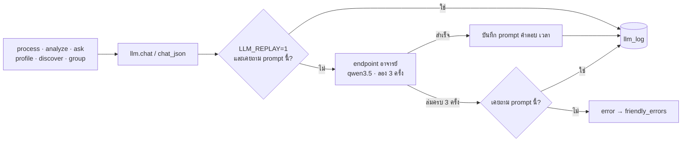

# พื้นฐานร่วม (LLM · ฐานข้อมูล · โหมดเดโม · โครง UI · เทส)

ส่วนที่ทุกระบบใช้ร่วมกัน:
- การเรียก LLM พร้อมบันทึกและเล่นคำตอบซ้ำ
- ฐานข้อมูล SQLite
- โหมดเดโมที่เปิดได้โดยไม่ต้องมีเน็ต
- โครงหน้าเว็บ
- ชุดเทส

## ภาพรวม



ดูแบบโต้ตอบ (archify): [llm-call.html](../diagrams/llm-call.html)

## LLM (`core/llm.py`)

- **endpoint:** `https://llm.nattee.net/v1/chat/completions` (แบบ OpenAI) โมเดล `qwen3.5` ปิดโหมดคิด (`enable_thinking: False`) timeout 120 วินาที
- **key:** `LLM_API_KEY` ใน `.env` (โหลดด้วย `python-dotenv`) ไม่มีจะ `RuntimeError` ซึ่งหน้าเว็บแปลงเป็นข้อความให้ใส่ key
- **ลองใหม่:** 3 ครั้ง รอ 1 และ 2 วินาทีระหว่างครั้ง
- **บันทึกทุก call** ใน `llm_log`:
  - key = sha256(โมเดล + system + prompt)
  - เก็บ prompt คำตอบ และเวลา (ms)
  - ใช้นับต้นทุนต่อรอบ (`db.llm_stats`) และแสดง "รอบนี้ใช้ LLM n ครั้ง (x วินาที)"
- **เล่นซ้ำ** (`LLM_REPLAY=1`): prompt เดิมทุกตัวอักษรใช้คำตอบเดิมจาก log ไม่เรียก LLM ใช้ตอนเดโมและทำให้ผลซ้ำได้
- **LLM ล่ม:** ลองครบ 3 ครั้งแล้วยังไม่ได้ จะใช้คำตอบเดิมของ prompt เดียวกันถ้ามี ไม่มีก็ raise
- **`chat_json`:** ตัด ```` ``` ```` ออกแล้ว `json.loads` · ทุกจุดที่เรียกจับ `JSONDecodeError` / `ValueError` เอง แล้วตรวจโครงสร้างคำตอบต่อ
- **ตัวนับ:** `call_count` (เรียกจริง) และ `replay_count` (ตอบจาก log) ใช้ในเทสและหน้าถามข้อมูล
- **อักษรจีน:** qwen บางครั้งหลุดภาษาจีน ทุกจุดที่แสดงข้อความ LLM ตัดด้วย `analyze.CJK` (รายงานให้เขียนใหม่ 1 ครั้งก่อน)
- **ทดสอบ:** `python -m core.llm` ต้องได้คำทักทายภาษาไทย และ `{'ok': True}`

จุดที่เรียก LLM ทั้งหมดและจำนวนครั้ง ดูตาราง "เอกสารรายระบบ" ใน [`architecture.md`](../architecture.md#เอกสารรายระบบ)

## ฐานข้อมูล (`core/db.py`)

- SQLite ไฟล์เดียว `data/app.db` (เปลี่ยนโฟลเดอร์ด้วย `CC_DATA_DIR` เช่น ชุดเดโมหรือเทส)
- `connect()`:
  - เปิด connection ใหม่ทุกครั้ง commit เมื่อสำเร็จ แล้วปิดเสมอ
  - `timeout=30` ให้หลายเธรดรอ lock แทนการ error (ดึงข้อมูล/จัดหมวดพร้อมกัน)
  - เปิด foreign key
- `init_db()`: สร้างตารางตาม `SCHEMA` และเพิ่มคอลัมน์ที่เพิ่มทีหลังให้ DB เก่าอัตโนมัติ (`MIGRATIONS`)
- ทุก query ใช้ parameter (`?`) และ `_in(ids)` สร้าง `?,?,?` สำหรับ `IN (...)`
- รายการตารางแบ่งกลุ่มดูใน [`architecture.md`](../architecture.md#ข้อมูล-sqlite-dataappdb) · บน cloud จะย้ายไป PostgreSQL ดู [`huawei-cloud.md`](../huawei-cloud.md) ข้อ 1

## โหมดเดโม

`run_demo.bat` ตั้ง 3 ค่าแล้วเปิดแอป:

| ค่า | ผล |
|---|---|
| `CC_DATA_DIR=demo` | ใช้ `demo/app.db` และ `demo/last_run.json` (ชุด MC vs AP, KCE, ฟู้ดแพชชั่น) |
| `CC_DEMO=1` | แถบบอกโหมดเดโมในหน้าภาพรวม · แท็บถามนับ "x วันล่าสุด" จากข่าวล่าสุดในชุดข้อมูลแทนวันนี้ |
| `LLM_REPLAY=1` | ผลวิเคราะห์และคำถามตัวอย่างตอบจาก `llm_log` ได้แม้ไม่มีเน็ต |

รายชื่อหุ้น SET และตัวเลขตลาดอยู่ใน `market_cache` ของชุดเดโม · คำถามใหม่และการวิเคราะห์ใหม่ยังต้องใช้เน็ต
งานเบื้องหลังได้ environment เดียวกัน (`watch_panel.start_background`)

## โครง UI

| ส่วน | ไฟล์ | หน้าที่ |
|---|---|---|
| จุดเริ่ม | `app.py` | ตั้งค่าหน้า สร้างเมนู แถบซ้าย (ชุดที่เปิดอยู่ + ความคืบหน้างาน) |
| เมนู | `ui/nav.py` | `st.navigation` 3 กลุ่ม: ภาพรวม · วิเคราะห์ใหม่ · ถามข้อมูล \| ติดตามอัตโนมัติ \| ข้อมูลภายใน · บริษัทและแหล่งข้อมูล · ตรวจความแม่น · `go(key)` เปลี่ยนหน้าจากโค้ด |
| หน้า | `ui/pages/*` | 1 ไฟล์ต่อหน้า มี `render()` |
| สถานะร่วม | `ui/state.py` | ผลที่เปิดอยู่ (`build_result`, `last_run.json`) · ค่าฟอร์มที่จำข้ามหน้า (`FORM_KEYS`) · งานเบื้องหลัง |
| ส่วนประกอบ | `ui/results.py`, `ui/sections/*`, `ui/*_panel.py`, `ui/charts.py`, `ui/insights.py` | หน้าผล แท็บเจาะลึก แผงต่าง ๆ กราฟ ประโยคสรุป |
| ข้อความ | `ui/labels.py` | ชื่อไทยของหมวด น้ำเสียง โหมด (ไม่มี streamlit จึงให้ `core/pipeline.py` ใช้ได้) |
| error | `ui/common.friendly_errors` | ไม่มี key → บอกให้ใส่ · เชื่อม LLM ไม่ได้ → บอกว่าข้อมูลที่ทำแล้วถูกบันทึก กดอีกครั้งทำต่อจากเดิม |

Streamlit ลบ state ของ widget ที่ไม่ได้แสดงในรอบนั้น ค่าฟอร์มจึงถูกเก็บสำเนาไว้ใน `st.session_state.setup` แล้วคืนให้ทุกครั้งที่เปิดหน้า (`restore_form` / `save_form`)

## เทส

- รัน: `pip install -r requirements-dev.txt` แล้ว `.venv\Scripts\python -m pytest` ไม่ใช้เน็ตหรือ LLM
- `tests/conftest.py`:
  - fixture `tmp_db` ให้ฐานข้อมูลใหม่ในโฟลเดอร์ชั่วคราวทุกเทส
  - `news(rows)` สร้าง DataFrame แบบเดียวกับ `analyze.load_df`
- `tests/test_ui_pages.py`: เปิดทุกหน้ากับสำเนาชุดเดโมด้วย `streamlit.testing` (แทนรายชื่อหุ้นด้วยรายการว่าง) และตรวจว่าไม่มี error, หน้าภาพรวมแสดงสรุปก่อน, ปุ่มเริ่มปิดจนกว่าจะมีคู่แข่ง 2 ราย, ฟอร์มจำค่าข้ามหน้า
- เทสของแต่ละระบบอยู่ในหัวข้อ "สำหรับนักพัฒนา" ของแต่ละไฟล์ · ส่วนที่ยังไม่มีเทส (ต้องใช้เน็ตหรือ LLM): การดึงข้อมูล การจัดหมวด หาคู่แข่ง บริษัทในเครือ

## ค่าที่ปรับได้

| ค่า | ที่ | ปัจจุบัน |
|---|---|---|
| endpoint / โมเดล | `llm.URL` / `llm.MODEL` | llm.nattee.net / qwen3.5 |
| จำนวนครั้งที่ลอง / timeout | `llm.chat(retries=3)` / `timeout=120` | 3 / 120 วินาที |
| env ทั้งหมด | `.env` (ดู `.env.example`) | `LLM_API_KEY` · `ALERT_WEBHOOK_URL` · `EMBED_BACKEND` · `EMBED_MODEL` · `OCR_URL` · `CC_DATA_DIR` · `CC_DEMO` · `LLM_REPLAY` |
